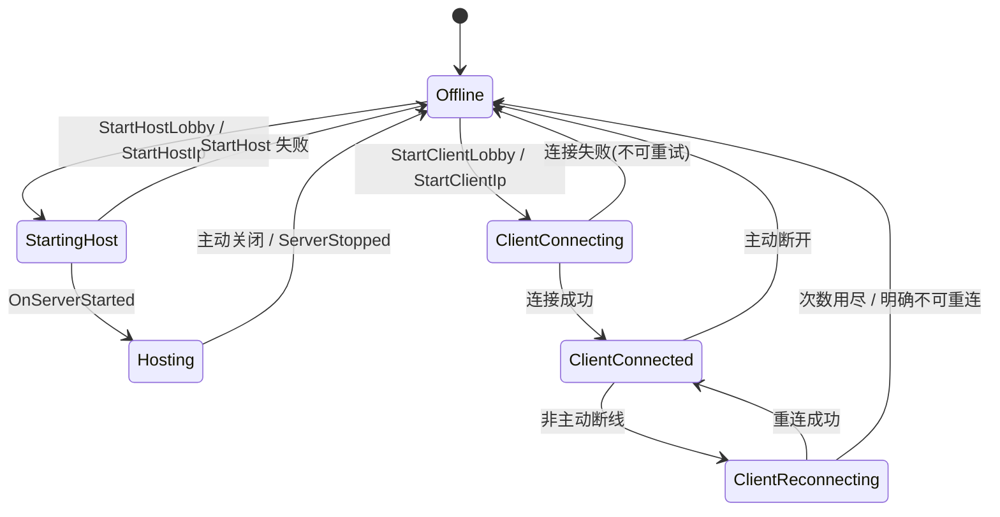
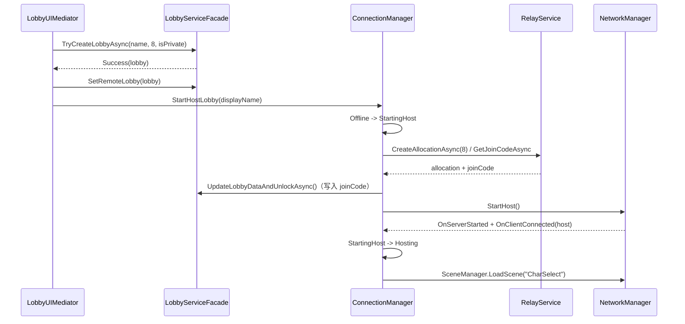
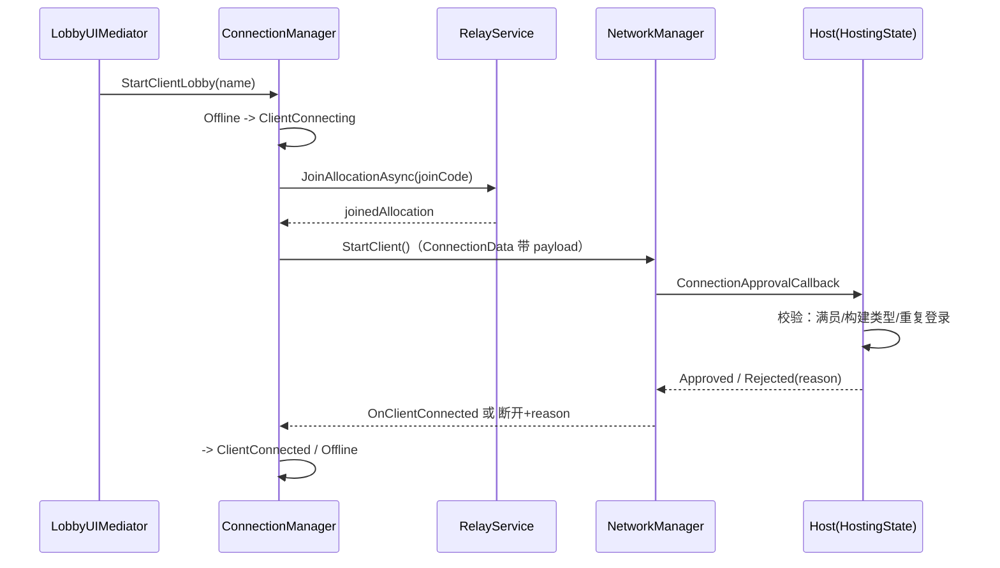

# 02 · 连接流程与状态机

> 读完你应该能回答：
> - 从"点 Join 按钮"到"`NetworkManager.StartClient()`"之间发生了什么？
> - 为什么要有 `Offline / ClientConnecting / ClientConnected / ClientReconnecting / StartingHost / Hosting` 六个状态？
> - 断线重连是怎么实现的？服务端怎么判断"你是老玩家回来了"？
> - `ConnectionApprovalCallback` 里应该做什么、不该做什么？

---

## 1. 全景：三块拼图

```
UI (MainMenu / IP 窗口)
   │   StartHostLobby / StartClientLobby / StartHostIp / StartClientIp
   ▼
ConnectionManager  ── 状态机，转发 NetworkManager 的回调 + 决定跳转
   │
   ├── ConnectionState 子类（每个状态一个类，只管"进入 / 退出 / 收到事件怎么办"）
   │
   └── ConnectionMethod（IP 直连 / Relay）── 负责"连之前"的准备工作
            │
            ├── 写 NetworkConfig.ConnectionData（payload：playerId/playerName/isDebug）
            └── 配置 UnityTransport（SetConnectionData / SetRelayServerData）
```

**核心思想**：`ConnectionMethod` 负责"**怎么连**"（传输层参数），`ConnectionState` 负责"**连的过程中发生什么**"（流程控制）。两者正交，所以新增一种连接方式（比如 Steam  sockets）只要加一个 `ConnectionMethod` 子类，不用动状态机。

---

## 2. `ConnectionManager`：一个"转发器"

文件：`Assets/Scripts/ConnectionManagement/ConnectionManager.cs`

它自己几乎没有业务逻辑，做三件事：

1. 持有 6 个状态实例（`internal readonly`，方便状态之间直接跳）；
2. 在 `Start()` 里用容器给每个状态做依赖注入；
3. 把 `NetworkManager` 的回调、UI 的入口调用**一律转发给当前状态**。

```csharp
// ConnectionManager.cs:86
void Start()
{
    List<ConnectionState> states = new() { m_Offline, m_ClientConnecting, m_ClientConnected,
                                           m_ClientReconnecting, m_StartingHost, m_Hosting };
    foreach (var connectionState in states)
    {
        m_Resolver.Inject(connectionState);   // 状态不是 MonoBehaviour，手动注入
    }
    m_CurrentState = m_Offline;

    NetworkManager.OnClientConnectedCallback += OnClientConnectedCallback;
    NetworkManager.OnClientDisconnectCallback += OnClientDisconnectCallback;
    NetworkManager.OnServerStarted += OnServerStarted;
    NetworkManager.ConnectionApprovalCallback += ApprovalCheck;
    NetworkManager.OnTransportFailure += OnTransportFailure;
    NetworkManager.OnServerStopped += OnServerStopped;
}
```

状态切换只有一个入口：

```csharp
// ConnectionManager.cs:114
internal void ChangeState(ConnectionState nextState)
{
    m_CurrentState?.Exit();
    m_CurrentState = nextState;
    m_CurrentState.Enter();
}
```

> 这是**状态模式（State Pattern）**的标准写法。对比"一个大类里 50 个 bool 标志 + if/else"，好处是：每个状态能独立阅读、独立测试，且"哪些事件在哪个状态有意义"一目了然。

### 2.1 六个状态一览

| 状态 | 何时进入 | 进入后做什么 | 收到关键事件后 |
| --- | --- | --- | --- |
| `OfflineState` | 初始 / 主动退出 / 重连失败 | 停 Lobby 跟踪、`NetworkManager.Shutdown()`、加载 MainMenu（普通 SceneManager）、按连接方式创建 `ConnectionMethod` | `StartHost*` → `StartingHost`；`StartClient*` → `ClientConnecting` |
| `StartingHostState` | 用户点 Host | `await SetupHostConnectionAsync()` → `StartHost()` | `OnServerStarted` → 发布 `ConnectStatus.Success` → `Hosting` |
| `HostingState` | 服务端已启动 | 加载 `CharSelect`（网络场景管理） | 新客户端 → `ApprovalCheck`；客户端断开 → 发 `ConnectionEventMessage`；自己停服 → `Offline` |
| `ClientConnectingState` | 用户点 Join | `await SetupClientConnectionAsync()` → `StartClient()` | 连上 → `ClientConnected`；失败 → 解析 `DisconnectReason` 决定是否回 `Offline` |
| `ClientConnectedState` | 已作为客户端连上 | `LobbyServiceFacade.BeginTracking()` | 断线 → 视原因进 `ClientReconnecting` 或 `Offline` |
| `ClientReconnectingState` | 非主动断线 | 协程：等 1s → 重连，最多 `NbReconnectAttempts` 次，每次间隔 5s | 成功 → `ClientConnected`；用尽 → `Offline` |



---

## 3. Payload：连接时带什么数据

Netcode 的连接审批允许客户端在 `StartClient` 前塞一段字节（`NetworkConfig.ConnectionData`）。Boss Room 塞的是 JSON：

```csharp
// ConnectionMethod.cs:45
public class ConnectionPayload
{
    public string playerId;    // 认证 PlayerId，或 本地GUID+Profile
    public string playerName;  // 显示名
    public bool isDebug;       // 是否 Debug 构建
}
```

```csharp
// ConnectionMethod.cs:55
protected void SetConnectionPayload(string playerId, string playerName)
{
    var payload = JsonUtility.ToJson(new ConnectionPayload { playerId = playerId, playerName = playerName, isDebug = Debug.isDebugBuild });
    m_ConnectionManager.NetworkManager.NetworkConfig.ConnectionData = Encoding.UTF8.GetBytes(payload);
}
```

`playerId` 的来源有一段"降级逻辑"：

```csharp
// ConnectionMethod.cs:76
protected string GetPlayerId()
{
    if (UnityServices.State != ServicesInitializationState.Initialized)
        return ClientPrefs.GetGuid() + m_ProfileManager.Profile;   // 没有 UGS 也能玩（IP 模式）
    return AuthenticationService.Instance.IsSignedIn
        ? AuthenticationService.Instance.PlayerId
        : ClientPrefs.GetGuid() + m_ProfileManager.Profile;
}
```

> **设计取舍**：官方注释明确说"客户端发来的 playerId 不可信，可能被冒充"，他们保留这种写法是为了 demo 简洁，真实项目要用服务端签发的 token。

---

## 4. 两种 `ConnectionMethod`

### 4.1 IP 直连（`ConnectionMethodIP`）

```csharp
public override async Task SetupHostConnectionAsync()
{
    SetConnectionPayload(GetPlayerId(), m_PlayerName);
    var utp = (UnityTransport)m_ConnectionManager.NetworkManager.NetworkConfig.NetworkTransport;
    utp.SetConnectionData(m_Ipaddress, m_Port);
}
```

Host 也要设 payload——**Host 本身也是 Client 0**，审批回调同样会跑。

### 4.2 Relay（`ConnectionMethodRelay`）

Host 侧：

```csharp
// ConnectionMethod.cs:185
var hostAllocation = await RelayService.Instance.CreateAllocationAsync(m_ConnectionManager.MaxConnectedPlayers, region: null);
var joinCode = await RelayService.Instance.GetJoinCodeAsync(hostAllocation.AllocationId);
m_LocalLobby.RelayJoinCode = joinCode;                       // 存到本地 Lobby 镜像
await m_LobbyServiceFacade.UpdateLobbyDataAndUnlockAsync();  // 把 join code 写进 Lobby 数据，供别人读
await m_LobbyServiceFacade.UpdatePlayerDataAsync(hostAllocation.AllocationIdBytes.ToString(), joinCode);
utp.SetRelayServerData(new RelayServerData(hostAllocation, k_DtlsConnType)); // "dtls"
```

Client 侧：

```csharp
// ConnectionMethod.cs:154
var joinedAllocation = await RelayService.Instance.JoinAllocationAsync(m_LocalLobby.RelayJoinCode);
await m_LobbyServiceFacade.UpdatePlayerDataAsync(joinedAllocation.AllocationId.ToString(), m_LocalLobby.RelayJoinCode);
utp.SetRelayServerData(new RelayServerData(joinedAllocation, k_DtlsConnType));
```

**要点**：
- Relay 只是**传输层**的事。对 Netcode 来说，`StartHost()` / `StartClient()` 完全不变，它不知道底下是直连还是中继。
- join code 存在 **Lobby 的 lobby data** 里（不是 player data），所以任何加入房间的人都能读到。
- 用 DTLS（加密），生产环境建议保持。

### 4.3 重连时的差异

```csharp
public override async Task<(bool success, bool shouldTryAgain)> SetupClientReconnectionAsync()
```

- IP 方式：什么都不用做，直接返回 `(true, true)`。
- Relay 方式：必须 `ReconnectToLobbyAsync()`，因为 Relay 会通知 Lobby "此人掉线"，Lobby 保留席位一段时间（Dashboard 上的 "Disconnect removal time"），重连成功才保住房间数据。

---

## 5. 服务端审批：`HostingState.ApprovalCheck`

这是**服务端唯一能拒绝连接的地方**，也是最容易写错的地方。

```csharp
// HostingState.cs:111
public override void ApprovalCheck(ConnectionApprovalRequest request, ConnectionApprovalResponse response)
{
    var connectionData = request.Payload;
    if (connectionData.Length > k_MaxConnectPayload)   // 1024 字节
    {
        response.Approved = false;                     // 防 DOS：立刻拒绝，不解析
        return;
    }

    var payload = Encoding.UTF8.GetString(connectionData);
    var connectionPayload = JsonUtility.FromJson<ConnectionPayload>(payload);
    var gameReturnStatus = GetConnectStatus(connectionPayload);

    if (gameReturnStatus == ConnectStatus.Success)
    {
        SessionManager<SessionPlayerData>.Instance.SetupConnectingPlayerSessionData(
            clientId, connectionPayload.playerId,
            new SessionPlayerData(clientId, connectionPayload.playerName, new NetworkGuid(), 0, true));

        response.Approved = true;
        response.CreatePlayerObject = true;   // 让 Netcode 自动生成 Default Player Prefab（PersistentPlayer）
        response.Position = Vector3.zero;
        response.Rotation = Quaternion.identity;
        return;
    }

    response.Approved = false;
    response.Reason = JsonUtility.ToJson(gameReturnStatus);   // 把原因序列化回客户端
    if (m_LobbyServiceFacade.CurrentUnityLobby != null)
        m_LobbyServiceFacade.RemovePlayerFromLobbyAsync(connectionPayload.playerId);
}
```

判定顺序（`GetConnectStatus`）：

```csharp
if (ConnectedClientsIds.Count >= MaxConnectedPlayers)  return ConnectStatus.ServerFull;      // 8 人上限
if (connectionPayload.isDebug != Debug.isDebugBuild)   return ConnectStatus.IncompatibleBuildType;
return SessionManager.Instance.IsDuplicateConnection(payload.playerId) ? LoggedInAgain : Success;
```

三个细节：

1. **`response.Reason` 是给客户端看的**。客户端在 `ClientConnectingState` 里把它反序列化成 `ConnectStatus` 再弹窗。
2. **`k_MaxConnectPayload` 的存在**是安全实践：不要对未知长度的字节做 JSON 解析。
3. **`isDebug` 校验**：Debug 构建（编辑器/Development Build）和 Release 构建的 Netcode 消息不兼容，提前拒绝比连上后花屏好。

> **不要在 `ApprovalCheck` 里做异步操作**（比如查数据库）。它是同步回调，一旦 `response.Approved` 被设置，Netcode 会立刻推进。要异步可以先设 `response.Pending = true`，处理完再设 `Approved` —— 本项目没用到，但 API 支持。

---

## 6. 断线重连的完整链路

这是本项目最"真实游戏"的部分。重连要解决两件事：**传输层重连** + **游戏状态恢复**。

### 6.1 触发：`ClientConnectedState`

```csharp
public override void OnClientDisconnect(ulong clientId)
{
    var reason = m_ConnectionManager.NetworkManager.DisconnectReason;
    if (string.IsNullOrEmpty(reason) || reason == "Disconnected due to host shutting down.")
        m_ConnectionManager.ChangeState(m_ConnectionManager.m_ClientReconnecting);
    else
        m_ConnectionManager.ChangeState(m_ConnectionManager.m_Offline);
}
```

"空 reason"通常意味着**网络中断**（而不是被服务端踢），这种情况值得尝试重连。

### 6.2 重连协程：`ClientReconnectingState`

```csharp
const float k_TimeBeforeFirstAttempt = 1;
const float k_TimeBetweenAttempts  = 5;
```

流程：

1. 先 `NetworkManager.Shutdown()`，等 `ShutdownInProgress == false`；
2. `SetupClientReconnectionAsync()`（Relay 情况下重新绑 Lobby）；
3. 发布 `ReconnectMessage(attempt, max)`，UI 弹"重连中 2/2"；
4. `StartClient()`，等待连接结果；
5. 成功 → `ClientConnected`；失败且次数未用尽 → 等 5s 再来；
6. 次数用尽 → 发布 `ConnectStatus.GenericDisconnect` → `Offline`。

**明确的"不重连"原因**（直接放弃，回 Offline）：

| 原因 | 含义 |
| --- | --- |
| `UserRequestedDisconnect` | 自己点的退出 |
| `HostEndedSession` | 房主关了房间 |
| `ServerFull` | 满员 |
| `IncompatibleBuildType` | 构建类型不匹配 |

### 6.3 状态恢复：`SessionManager<SessionPlayerData>`

重连能"回到原来的角色"，靠的是服务端用 **playerId（而不是 clientId）** 索引的会话表：

- 连接时 `SetupConnectingPlayerSessionData(clientId, playerId, data)` 建立 `clientId ↔ playerId` 映射；
- 断线时 `DisconnectClient(clientId)` 只把 `IsConnected = false`，**数据保留**（`m_HasSessionStarted == true` 时）；
- 重连后新 clientId 通过同一个 playerId 找回旧数据；
- `ServerBossRoomState.SpawnPlayer` 发现 `HasCharacterSpawned == true` 时，用保存的 position/rotation/HP 复原。

详见 [07-网络同步机制与工具](07-网络同步机制与工具.md) 的 Session 一节。

### 6.4 Host 侧的重连配合

- `HostingState.OnClientDisconnect`：如果是别的客户端断开，发 `ConnectionEventMessage(GenericDisconnect, playerName)`，然后 `SessionManager.DisconnectClient`（保留数据）；
- 玩家重新连上时，`ServerBossRoomState.OnSynchronizeComplete` 检测"这个人没有角色"→ 走 LateJoin 生成。

---

## 7. `ConnectStatus` 枚举：所有失败都有"名字"

```csharp
public enum ConnectStatus
{
    Undefined,
    Success,
    ServerFull,            // 房间满
    LoggedInAgain,         // 同一账号在别处登录
    UserRequestedDisconnect,
    GenericDisconnect,
    Reconnecting,
    IncompatibleBuildType, // Debug/Release 不匹配
    HostEndedSession,      // 房主结束
    StartHostFailed,
    StartClientFailed,
}
```

它通过 `MessageChannel<ConnectStatus>` 发给 UI，`ConnectionStatusMessageUIManager` 把每个值映射成一句人话的弹窗。**新增失败原因时，编译器的 `switch` 会提醒你去补 UI 文案**（默认分支会 `Debug.LogWarning`）。

> 这是"用类型系统管理错误"的好例子：不要传 `string errorMessage`，传枚举 + 集中映射。

---

## 8. 时序图

### 8.1 Host 启动（Relay + Lobby）



### 8.2 客户端加入



---

## 9. 常见坑

| 坑 | 说明 |
| --- | --- |
| `StartHost()` 后立刻 `LoadScene` | 必须等 `OnServerStarted`。`StartingHostState` 就是这么做的 |
| 在 `OfflineState.Enter` 里用 `NetworkSceneManager` | 此时网络未启动，会 NPE，所以用普通 `SceneManager` |
| 客户端主动退出时也走重连 | `OnlineState.OnUserRequestedShutdown` 会先发布 `UserRequestedDisconnect` 再切到 `Offline`；等 Netcode 的断线回调到达时，当前状态已是 `OfflineState`（它不处理断线），所以不会触发重连。**顺序很重要** |
| 重连后 clientId 变了 | 业务代码不要缓存 clientId 作为玩家标识，用 playerId |
| `response.Reason` 里塞中文 | 能跑，但建议枚举；本项目用 `JsonUtility.ToJson(ConnectStatus.X)` |

---

## 10. 本章练习

1. **加一个状态**：实现 `PausedState`（例如暂停菜单时屏蔽输入），在 `HostingState` 里加一个 `OnPause` 跳转，体会 `Enter/Exit` 的对称性。
2. **改重连次数**：把 `m_NbReconnectAttempts` 改成 5，在两个客户端里用防火墙阻断 8 秒，观察弹窗计数与最终结果。
3. **加一种失败原因**：`ConnectStatus.VersionMismatch`，在 `ApprovalCheck` 里比较 `Application.version`，并补 UI 文案。这能完整体验"枚举 → 服务端拒绝 → 客户端解析 → UI 展示"。
4. **读代码**：`OfflineState.Enter` 如何避免"重复 Shutdown 导致警告"？（提示：`ShutdownInProgress`）

---

上一章：[01-启动与依赖注入](01-启动与依赖注入.md) ｜ 下一章：[03-大厅-中继-认证](03-大厅-中继-认证.md)
