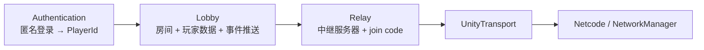
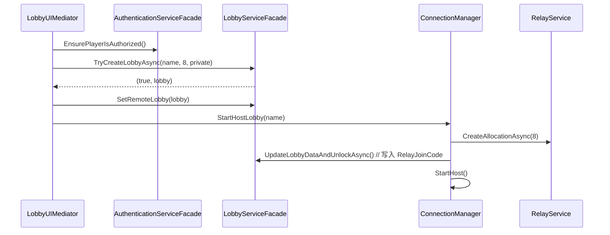

# 03 · 大厅、中继与认证

> 读完你应该能回答：
> - Unity Lobby / Relay / Authentication 在游戏里各自负责什么？和 Netcode 是什么关系？
> - `LocalLobby` / `LocalLobbyUser` 为什么要存在？它和云端 `Lobby` 对象什么关系？
> - Lobby 的 heartbeat、事件订阅、重连分别解决什么问题？
> - 玩家数据（名字、Relay allocation）是怎么在 Lobby 里同步的？

---

## 1. 三个云服务，三条边界



| 服务 | 提供什么 | 本项目怎么用 | 和 Netcode 的关系 |
| --- | --- | --- | --- |
| **Authentication** | 稳定的 `PlayerId`（跨设备、跨会话） | 匿名登录，`playerId` 放进连接 payload | 无直接关系，只是"身份来源" |
| **Lobby** | 房间 CRUD、玩家列表、自定义 key-value、WebSocket 事件推送、heartbeat | 房间浏览/加入、Relay join code 的载体、"xxx 离开"的检测 | 无直接关系，是**元数据层** |
| **Relay** | 中继服务器分配、join code | 把 `RelayServerData` 交给 UTP | **传输层**，`StartHost/StartClient` 不变 |

> **关键认知**：Lobby 和 Relay 都是"连接之前的准备工作"。一旦 Netcode 连上，游戏内的同步完全由 Netcode 负责，Lobby 只用于"房间还在不在 / 谁离开了"。

---

## 2. 认证：`AuthenticationServiceFacade`

文件：`Assets/Scripts/UnityServices/Auth/AuthenticationServiceFacade.cs`

它是一层薄封装，四个方法：

| 方法 | 用途 |
| --- | --- |
| `GenerateAuthenticationOptions(profile)` | 构造 `InitializationOptions`，把 profile 名传进去 |
| `InitializeAndSignInAsync(options)` | `UnityServices.InitializeAsync` + `SignInAnonymouslyAsync` |
| `SwitchProfileAndReSignInAsync(profile)` | 切换 profile（"Change Profile"按钮） |
| `EnsurePlayerIsAuthorized()` | 每次 Lobby 操作前调用，未登录就补登录 |

统一错误处理：所有异常都转成 `UnityServiceErrorMessage` 发到消息总线，UI 层统一弹窗。

### 2.1 Profile 是什么

Boss Room 支持"同一台机器上多个玩家"（联调必需）。Unity Authentication 用 **profile** 隔离本地凭据：

```csharp
// Utils/ProfileManager.cs:67
static string GetProfile()
{
    var arguments = Environment.GetCommandLineArgs();
    for (int i = 0; i < arguments.Length; i++)
        if (arguments[i] == AuthProfileCommandLineArg)   // -AuthProfile
            return arguments[i + 1];

#if UNITY_EDITOR
    // 编辑器里用 dataPath 的 MD5 前 30 位做唯一 ID
    var hashedBytes = MD5.Create().ComputeHash(Encoding.UTF8.GetBytes(Application.dataPath));
    Array.Resize(ref hashedBytes, 16);
    return new Guid(hashedBytes).ToString("N")[..30];
#else
    return "";
#endif
}
```

- 编辑器：同一个工程目录永远同一个 profile；
- 两个编辑器副本 / 打包版：用 `-AuthProfile player2` 区分；
- profile 名字有 30 字符上限（Auth 服务的限制），所以截断 GUID。

### 2.2 登录失败不影响单机

`GetPlayerId()` 里有降级：UGS 未初始化时用 `ClientPrefs.GetGuid() + Profile`。所以 **IP 直连模式完全不需要 UGS**，这是官方刻意保留的学习路径。

---

## 3. `LocalLobby`：云端的本地镜像

文件：`Assets/Scripts/UnityServices/Lobbies/LocalLobby.cs`

### 3.1 为什么要镜像

云端的 `Unity.Services.Lobbies.Models.Lobby` 是"某一时刻的快照"，不适合直接绑 UI：

- UI 需要 `event changed` 来刷新；
- 需要在客户端**预测性**修改（比如本地立刻显示"我加入了"）；
- 需要把 `Dictionary<string, DataObject>` 解析成强类型字段。

所以项目做了两层：

```
Lobby(远程)  ──ApplyRemoteData──▶  LocalLobby(本地镜像) + LocalLobbyUser*  
                                          │
                                          └── event changed ──▶ UI 刷新
```

### 3.2 数据结构

```csharp
public sealed class LocalLobby
{
    public event Action<LocalLobby> changed;
    public struct LobbyData { LobbyID, LobbyCode, RelayJoinCode, LobbyName, Private, MaxPlayerCount }
    Dictionary<string, LocalLobbyUser> m_LobbyUsers;

    public Dictionary<string, DataObject> GetDataForUnityServices() => new()
    {
        {"RelayJoinCode", new DataObject(DataObject.VisibilityOptions.Public, RelayJoinCode)}
    };
}
```

注意 `RelayJoinCode` 是 **Public visibility**：任何能看到这个 Lobby 的人都能读到 join code 并加入 Relay。

`LocalLobbyUser` 同理，用 `Member` 可见性存 `DisplayName`。

### 3.3 合并远端数据

```csharp
// LocalLobby.cs:234（节选）
info.RelayJoinCode = lobby.Data.ContainsKey("RelayJoinCode") ? lobby.Data["RelayJoinCode"].Value : null;
```

注释解释了为什么 join code 放在 lobby data 而不是 player data：
> "By providing RelayCode through the lobby data with Member visibility, we ensure a client is connected to the lobby before they could attempt a relay connection, preventing timing issues between them."

即：**先加入 Lobby，才能读到 join code**，天然避免了"还没进房间就尝试连 Relay"的时序问题。

---

## 4. `LobbyServiceFacade`：所有 Lobby 调用的唯一出口

文件：`Assets/Scripts/UnityServices/Lobbies/LobbyServiceFacade.cs`（550 行，是全项目最"服务端 API"的一层）

### 4.1 生命周期

```csharp
public class LobbyServiceFacade : IDisposable, IStartable
{
    [Inject] LifetimeScope m_ParentScope;
    [Inject] UpdateRunner m_UpdateRunner;
    [Inject] LocalLobby m_LocalLobby;
    [Inject] LocalLobbyUser m_LocalUser;
    [Inject] IPublisher<UnityServiceErrorMessage> m_UnityServiceErrorMessagePub;
    [Inject] IPublisher<LobbyListFetchedMessage> m_LobbyListFetchedPub;
```

- `IStartable` → 被注册为 EntryPoint，容器建好后调用 `Start()`；
- `Start()` 里 `m_ParentScope.CreateChild(...)` 建一个子容器专门放 `LobbyAPIInterface`，这样 API 层可以独立替换/测试；
- `Dispose()` → `EndTracking()`，退出时清理房间。

### 4.2 频率限制（Rate Limit）——真实项目必须处理

Lobby 服务对 API 调用有严格频率限制（比如 30 秒 5 次）。项目为四类操作各配了一个 `RateLimitCooldown`：

```csharp
m_RateLimitQuery    = new RateLimitCooldown(1f);
m_RateLimitJoin     = new RateLimitCooldown(3f);
m_RateLimitQuickJoin= new RateLimitCooldown(10f);
m_RateLimitHost     = new RateLimitCooldown(3f);
```

调用前 `CanCall`，捕获到 `RateLimited` 时 `PutOnCooldown()`。**不要忽略这个模式**——很多独立游戏上线后被 Lobby 限流打爆就是因为没做这层。

### 4.3 Heartbeat：让房间"活着"

Lobby 服务需要 host 定期 ping，否则判定为僵尸房间自动删除。

```csharp
const float k_HeartbeatPeriod = 8;  // 服务端限制 30s/5 次，这里取更保守的 8s

// BeginTracking()（仅 host）
m_HeartbeatTime = 0;
m_UpdateRunner.Subscribe(DoLobbyHeartbeat, 1.5f);

// DoLobbyHeartbeat
m_HeartbeatTime += dt;
if (m_HeartbeatTime > k_HeartbeatPeriod) { m_HeartbeatTime -= k_HeartbeatPeriod; SendHeartbeatPing(...); }
```

> 用 `UpdateRunner`（1.5s tick）而不是协程，正是 [01](01-启动与依赖注入.md) 里讲的那个基础设施的典型用例。

### 4.4 事件订阅：`BeginTracking` / `EndTracking`

```csharp
async void SubscribeToJoinedLobbyAsync()
{
    var cb = new LobbyEventCallbacks();
    cb.LobbyChanged += OnLobbyChanges;
    cb.KickedFromLobby += OnKickedFromLobby;
    cb.LobbyEventConnectionStateChanged += OnLobbyEventConnectionStateChanged;
    m_LobbyEvents = await m_LobbyApiInterface.SubscribeToLobby(m_LocalLobby.LobbyID, cb);
}
```

`OnLobbyChanges` 里做两件事（`LobbyServiceFacade.cs:243`）：

1. `changes.ApplyToLobby(CurrentUnityLobby)` + `m_LocalLobby.ApplyRemoteData(...)` → 镜像更新；
2. **如果不是 host，检查 host 是否还在**：不在就提示 "Host left the lobby" 并 `EndTracking()`。
   这样即使 Netcode 的断线回调因为网络问题延迟，UI 也能立刻反应。

`EndTracking` 做对称清理：

```csharp
UnsubscribeToJoinedLobbyAsync();
if (m_LocalUser.IsHost) { m_UpdateRunner.Unsubscribe(DoLobbyHeartbeat); DeleteLobbyAsync(); }
else                     { LeaveLobbyAsync(); }
```

### 4.5 一个容易忽略的编辑器坑

```csharp
#if UNITY_EDITOR
    try { await m_LobbyEvents.UnsubscribeAsync(); }
    catch (WebSocketException e) { Debug.Log(e.Message); }  // 退出 Play 模式时 Wire 已关闭 websocket
#else
    await m_LobbyEvents.UnsubscribeAsync();
#endif
```

**在编辑器里直接退出 Play 模式**会先关 WebSocket，再执行 `Unsubscribe` 就会抛 `WebSocketException`。官方用 try/catch 吞掉——这类"编辑器专属异常"很常见，值得记住。

---

## 5. UI → Lobby → Relay 的完整调用链

以"创建房间"为例（`Gameplay/UI/Lobby/LobbyUIMediator.cs`）：

```csharp
public async void CreateLobbyRequest(string lobbyName, bool isPrivate)
{
    BlockUIWhileLoadingIsInProgress();

    bool playerIsAuthorized = await m_AuthenticationServiceFacade.EnsurePlayerIsAuthorized();
    if (!playerIsAuthorized) { UnblockUIAfterLoadingIsComplete(); return; }

    var lobbyCreationAttempt = await m_LobbyServiceFacade.TryCreateLobbyAsync(
        lobbyName, m_ConnectionManager.MaxConnectedPlayers, isPrivate);

    if (lobbyCreationAttempt.Success)
    {
        m_LocalUser.IsHost = true;
        m_LobbyServiceFacade.SetRemoteLobby(lobbyCreationAttempt.Lobby);
        m_ConnectionManager.StartHostLobby(m_LocalUser.DisplayName);  // ← 进入连接状态机
    }
    else UnblockUIAfterLoadingIsComplete();
}
```

加入房间（`JoinLobbyWithCodeRequest` / `JoinLobbyRequest` / `QuickJoinRequest`）结构相同，成功后：

```csharp
void OnJoinedLobby(Lobby remoteLobby)
{
    m_LobbyServiceFacade.SetRemoteLobby(remoteLobby);
    m_ConnectionManager.StartClientLobby(m_LocalUser.DisplayName);
}
```

**注意分工**：UI 只负责"调服务 + 切 UI 状态"，**不碰 NetworkManager**。所有网络动作都通过 `ConnectionManager` 的四个入口方法。



---

## 6. `LobbyAPIInterface`：为什么要再包一层

文件：`Assets/Scripts/UnityServices/Lobbies/LobbyAPIInterface.cs`

它只做"参数整形 + 调用 SDK"，例如：

```csharp
public async Task<Lobby> CreateLobby(string requesterUasId, string lobbyName, int maxPlayers, bool isPrivate,
                                     Dictionary<string, PlayerDataObject> hostUserData, Dictionary<string, DataObject> lobbyData)
```

好处：

1. `LobbyServiceFacade` 里不出现 SDK 的具体签名，方便替换/升级；
2. 查询时统一限制 `Count = k_MaxLobbiesToShow (16)`；
3. 单一位置处理 SDK 的 `LobbyServiceException` 语义。

---

## 7. Lobby 数据的字段约定

| 位置 | key | 可见性 | 含义 |
| --- | --- | --- | --- |
| Lobby data | `RelayJoinCode` | Public | Relay join code，客户端凭它加入中继 |
| Player data | `DisplayName` | Member | 玩家显示名 |
| Player data（SDK 内建） | `AllocationId` / `ConnectionInfo` | — | 由 `UpdatePlayer(...)` 传入，Lobby 借此知道"这个玩家在 Relay 上的分配"，从而做断线检测 |

---

## 8. 本章练习

1. **观察事件推送**：在 `OnLobbyChanges` 里打印 `changes` 的内容，用两个客户端加入/离开，观察哪些字段变化会触发事件。
2. **关掉 heartbeat**：注释 `Subscribe(DoLobbyHeartbeat, 1.5f)`，创建一个房间后不管它，等 30~60 秒观察房间是否从列表消失。
3. **用 IP 模式跳过 UGS**：MainMenu 选 `IP Host`，确认 `AuthenticationServiceFacade` 完全没被调用（断点或日志），理解"云服务是可选的"。
4. **加一个 lobby 数据**：把"当前地图/难度"放进 Lobby data（`DataObject.VisibilityOptions.Public`），在 CharSelect UI 显示。体会 `GetDataForUnityServices` / `ApplyRemoteData` 的对称改动。

---

上一章：[02-连接流程与状态机](02-连接流程与状态机.md) ｜ 下一章：[04-场景与游戏状态](04-场景与游戏状态.md)
