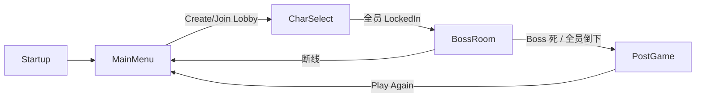

# 04 · 场景即游戏状态

> 读完你应该能回答：
> - 为什么 `GameStateBehaviour` 要继承 `LifetimeScope`？它带来了什么保证？
> - CharSelect 的选座/准备/锁定的数据是怎么同步的？为什么用 `NetworkList`？
> - 玩家角色是什么时候生成的？晚加入（Late Join）怎么处理？
> - 胜负判定在哪里、怎么切到 PostGame？

---

## 1. `GameStateBehaviour`：一个兼任 DI 容器的状态对象

文件：`Assets/Scripts/Gameplay/GameState/GameStateBehaviour.cs`

```csharp
public enum GameState { MainMenu, CharSelect, BossRoom, PostGame }

public abstract class GameStateBehaviour : LifetimeScope
{
    public virtual bool Persists => false;
    public abstract GameState ActiveState { get; }

    private static GameObject s_ActiveStateGO;   // 全局唯一

    protected override void Awake()
    {
        base.Awake();
        if (Parent != null) Parent.Container.Inject(this);  // 从父容器注入依赖
    }

    protected virtual void Start()
    {
        if (s_ActiveStateGO != null)
        {
            if (s_ActiveStateGO == gameObject) return;

            var previousState = s_ActiveStateGO.GetComponent<GameStateBehaviour>();
            if (previousState.Persists && previousState.ActiveState == ActiveState)
            {
                Destroy(gameObject);   // 新的场景里的同状态对象让位给持久化的旧对象
                return;
            }
            Destroy(s_ActiveStateGO);
        }

        s_ActiveStateGO = gameObject;
        if (Persists) DontDestroyOnLoad(gameObject);
    }

    protected override void OnDestroy()
    {
        if (!Persists) s_ActiveStateGO = null;
    }
}
```

**它同时是"状态"和"DI 作用域"**：
- 作为 `LifetimeScope`，它可以注册本状态专属的依赖（例如 `ServerCharSelectState` 注册自己需要的 UI/服务），场景卸载时容器自动销毁，不会泄漏；
- 作为 `GameStateBehaviour`，它保证**同一时刻只有一个状态对象**（host 上 server 版和 client 版各一个，属于不同子类）。

### 1.1 状态迁移是"隐式"的

注释写得很清楚（`GameStateBehaviour.cs:19-26`）：

> "They are driven implicitly by calling `NetworkManager.SceneManager.LoadScene` in server code."

即**没有** `TransitionTo(GameState)` 这样的显式状态机，而是：

```
服务端 LoadScene("BossRoom")  →  场景加载完成  →  旧场景的 GameState 被销毁，新场景的 GameState.Start() 抢占 s_ActiveStateGO
```

好处：状态与场景**永远不会不一致**（不需要在代码里同步两套东西）。代价：状态迁移的时机被场景加载绑架，做"战斗中途暂停/返回菜单"这类需求时要自己加逻辑。

### 1.2 `Persists` 的用途

Boss Room 里只有少数 UI 状态需要跨场景（本项目实际都返回 `false`，但机制保留）。它的语义是：
**如果新场景里有同类型的持久状态，就复用它；否则销毁旧的**。

---

## 2. 四个状态与场景的对应

| 场景 | 服务端状态 | 客户端状态 | 何时加载 |
| --- | --- | --- | --- |
| `Startup` | — | — | 永远不卸载 |
| `MainMenu` | — | `ClientMainMenuState` | `ApplicationController.Start()` |
| `CharSelect` | `ServerCharSelectState` | `ClientCharSelectState` | `HostingState.Enter()`（网络场景） |
| `BossRoom` | `ServerBossRoomState` | 同一个 `ServerBossRoomState`（客户端上 `enabled = false`） | CharSelect 全员准备 → 3 秒后 |
| `PostGame` | `ServerPostGameState` | 无独立状态类，由 `PostGameUI` 读 `NetworkPostGame` | 胜负判定 → 延时后 |



---

## 3. CharSelect：一个"网络版的选人房间"

### 3.1 数据模型：`NetworkCharSelection`

文件：`Assets/Scripts/Gameplay/GameState/NetworkCharSelection.cs`

```csharp
public class NetworkCharSelection : NetworkBehaviour
{
    public enum SeatState : byte { Inactive, Active, LockedIn }

    public struct LobbyPlayerState : INetworkSerializable, IEquatable<LobbyPlayerState>
    {
        public ulong ClientId;
        private FixedPlayerName m_PlayerName;   // 定长字符串，见下方注释
        public int PlayerNumber;                // P1/P2...
        public int SeatIdx;                     // -1 = 未选座
        public float LastChangeTime;
        public SeatState SeatState;

        public void NetworkSerialize<T>(BufferSerializer<T> serializer) where T : IReaderWriter
        {
            serializer.SerializeValue(ref ClientId);
            serializer.SerializeValue(ref m_PlayerName);
            serializer.SerializeValue(ref PlayerNumber);
            serializer.SerializeValue(ref SeatState);
            serializer.SerializeValue(ref SeatIdx);
            serializer.SerializeValue(ref LastChangeTime);
        }
    }

    private NetworkList<LobbyPlayerState> m_LobbyPlayers;   // 服务端可写，客户端只读
    public NetworkVariable<bool> IsLobbyClosed { get; } = new NetworkVariable<bool>(false);
    public event Action<ulong, int, bool> OnClientChangedSeat;

    [Rpc(SendTo.Server, RequireOwnership = false)]
    public void ServerChangeSeatRpc(ulong clientId, int seatIdx, bool lockedIn)
        => OnClientChangedSeat?.Invoke(clientId, seatIdx, lockedIn);
}
```

两个值得学的细节：

1. **`FixedPlayerName`（定长字符串）在 `INetworkSerializable` 里，而不是 `INetworkSerializeByMemcpy`**
   源码注释（第 23-28 行）解释得很直白：`FixedString` 放在 memcpy 结构里会把 4 字节的空字符串膨胀成 132 字节。**别为了省事把所有结构都标成 memcpy**。
2. **`NetworkList` 而不是 `NetworkVariable<List<>>`**
   `NetworkList` 会按元素增量同步（Add/Remove/Set），且带 `OnListChanged` 事件；`NetworkVariable<List<T>>` 每次改动都要序列化整个列表。

### 3.2 服务端逻辑：`ServerCharSelectState`

文件：`Assets/Scripts/Gameplay/GameState/ServerCharSelectState.cs`

生命周期（`OnNetworkSpawn`）：

```csharp
if (!NetworkManager.Singleton.IsServer) { enabled = false; return; }

NetworkManager.OnClientDisconnectCallback += OnClientDisconnectCallback;
networkCharSelection.OnClientChangedSeat += OnClientChangedSeat;
NetworkManager.SceneManager.OnSceneEvent += OnSceneEvent;
```

选座处理 `OnClientChangedSeat`（第 40 行起）的规则很多，正是"房间逻辑"的精髓：

```csharp
if (networkCharSelection.IsLobbyClosed.Value) return;            // 已锁定，忽略

if (newSeatIdx == -1) lockedIn = false;                          // 没座位不能准备

// 该座位已被别人锁定？→ 把请求者置为 Inactive（没抢到）
foreach (... if (playerInfo.SeatIdx == newSeatIdx && playerInfo.SeatState == LockedIn)
    { networkCharSelection.LobbyPlayers[idx] = ...SeatState.Inactive; return; }

// 正常写入
networkCharSelection.LobbyPlayers[idx] = new LobbyPlayerState(clientId, name, playerNumber,
    lockedIn ? SeatState.LockedIn : SeatState.Active, newSeatIdx, Time.time);

// 如果这次是"锁定"，把同座位的其他人踢成 Inactive（手慢无）
if (lockedIn) { foreach (... SeatIdx == newSeatIdx && i != idx) ... }

CloseLobbyIfReady();
```

`CloseLobbyIfReady()`：

```csharp
foreach (var p in networkCharSelection.LobbyPlayers)
    if (p.SeatState != SeatState.LockedIn) return;    // 还有人没准备

networkCharSelection.IsLobbyClosed.Value = true;
SaveLobbyResults();
m_WaitToEndLobbyCoroutine = StartCoroutine(WaitToEndLobby());   // 3 秒后 LoadScene("BossRoom")
```

`SaveLobbyResults()` 把"座位 → Avatar GUID"写进每个玩家的 **`PersistentPlayer`**（注意不是 avatar，因为 avatar 还没生成）：

```csharp
persistentPlayer.NetworkAvatarGuidState.AvatarGuid.Value =
    networkCharSelection.AvatarConfiguration[playerInfo.SeatIdx].Guid.ToNetworkGuid();
```

### 3.3 晚加入者

有人加载完 CharSelect 就自动分配座位：

```csharp
void OnSceneEvent(SceneEvent sceneEvent)
{
    if (sceneEvent.SceneEventType != SceneEventType.LoadComplete) return;
    // 客户端加载完 CharSelect → 给它排一个座位
}
```

细节：如果此时 `IsLobbyClosed == true`，会调用 `CancelCloseLobby()`（停协程 + 置 false），让新玩家也能选人——这就是"3 秒延时"存在的意义。

### 3.4 客户端：`ClientCharSelectState`

文件：`Assets/Scripts/Gameplay/GameState/ClientCharSelectState.cs`（447 行，UI 相关）

职责：
- 监听 `NetworkList.OnListChanged`，重建/刷新座位 UI（`UICharSelectPlayerSeat`）；
- 玩家点座位 → `networkCharSelection.ServerChangeSeatRpc(NetworkManager.LocalClientId, seatIdx, false)`；
- 点 Ready → 同一个 RPC，`lockedIn: true`；
- 选中角色时用 `CharacterSwap` 在场景里做**纯客户端**的模型预览（不生成网络对象）。

> 这是"服务端权威 + 客户端表现"的典型：客户端只是发"我想坐 3 号位"，能不能坐由服务端判定并广播结果。

---

## 4. BossRoom：角色生成与胜负

文件：`Assets/Scripts/Gameplay/GameState/ServerBossRoomState.cs`

### 4.1 为什么不在 `Start()` 里生成玩家

角色必须在**所有客户端都加载完场景之后**才能生成，否则：

- 客户端还在加载，spawn 消息可能先到，导致"对象在错误的场景里"；
- 玩家出生点需要场景里的 `Transform`，客户端未加载时引用不成立。

所以用 `NetworkSceneManager` 的回调：

```csharp
void OnLoadEventCompleted(string sceneName, LoadSceneMode mode, List<ulong> clientsCompleted, List<ulong> clientsTimedOut)
{
    if (!InitialSpawnDone && mode == LoadSceneMode.Single)
    {
        InitialSpawnDone = true;
        foreach (var kvp in NetworkManager.Singleton.ConnectedClients)
            SpawnPlayer(kvp.Key, lateJoin: false);
    }
}
```

### 4.2 晚加入 / 重连：`OnSynchronizeComplete`

```csharp
void OnSynchronizeComplete(ulong clientId)
{
    if (InitialSpawnDone && !PlayerServerCharacter.GetPlayerServerCharacter(clientId))
        SpawnPlayer(clientId, lateJoin: true);   // 同步完才生成，避免状态错乱
}
```

### 4.3 `SpawnPlayer` 做了什么

```csharp
void SpawnPlayer(ulong clientId, bool lateJoin)
{
    // 1. 随机取一个出生点（每个出生点只用一次）
    Transform spawnPoint = m_PlayerSpawnPointsList[Random.Range(0, count)];
    m_PlayerSpawnPointsList.RemoveAt(index);

    // 2. 找到这个玩家的 PersistentPlayer（连接审批时由 Netcode 自动创建）
    var playerNetworkObject = NetworkManager.Singleton.SpawnManager.GetPlayerNetworkObject(clientId);
    var persistentPlayer = playerNetworkObject.GetComponent<PersistentPlayer>();

    // 3. 生成 avatar（ServerCharacter）
    var newPlayer = Instantiate(m_PlayerPrefab, Vector3.zero, Quaternion.identity);
    var physicsTransform = newPlayer.GetComponent<ServerCharacter>().physicsWrapper.Transform;

    // 4. 重连时用 SessionManager 里保存的位置
    if (lateJoin && SessionManager<SessionPlayerData>.Instance.GetPlayerData(clientId) is { HasCharacterSpawned: true } data)
        physicsTransform.SetPositionAndRotation(data.PlayerPosition, data.PlayerRotation);

    // 5. 把名字和 Avatar GUID 从 PersistentPlayer 复制到 avatar
    networkAvatarGuidState.AvatarGuid = new NetworkVariable<NetworkGuid>(persistentPlayer.NetworkAvatarGuidState.AvatarGuid.Value);
    networkNameState.Name = new NetworkVariable<FixedPlayerName>(persistentPlayer.NetworkNameState.Name.Value);

    // 6. 以该客户端为 owner 生成（destroyWithScene: true）
    newPlayer.SpawnWithOwnership(clientId, true);
}
```

**注意第 5 步的写法**：先 `new NetworkVariable<T>(value)` 再赋值，是为了让值在 `OnNetworkSpawn` 时**已经就绪**。如果先生成再赋值，客户端在 `OnNetworkSpawn` 里会读到默认值。

### 4.4 胜负判定

`ServerBossRoomState` 订阅 `LifeStateChangedEventMessage`（**网络消息**，服务端发布、客户端接收）：

```csharp
void OnLifeStateChangedEventMessage(LifeStateChangedEventMessage message)
{
    switch (message.CharacterType)
    {
        case Tank: case Archer: case Mage: case Rogue:
            if (message.NewLifeState == LifeState.Fainted) CheckForGameOver();
            break;
        case ImpBoss:
            if (message.NewLifeState == LifeState.Dead) BossDefeated();
            break;
    }
}
```

- `CheckForGameOver()`：遍历所有玩家，只要有一个 `Alive` 就返回；否则 `CoroGameOver(k_LoseDelay = 2.5f, false)`。
- `BossDefeated()`：`CoroGameOver(k_WinDelay = 7f, true)`。
- `CoroGameOver`：先 `PersistentGameState.SetWinState(...)`，等一会儿（放动画），再 `LoadScene("PostGame", useNetworkSceneManager: true)`。

```csharp
IEnumerator CoroGameOver(float wait, bool gameWon)
{
    m_PersistentGameState.SetWinState(gameWon ? WinState.Win : WinState.Loss);
    yield return new WaitForSeconds(wait);
    SceneLoaderWrapper.Instance.LoadScene("PostGame", useNetworkSceneManager: true);
}
```

`PersistentGameState` 是根容器里的单例（见 [01](01-启动与依赖注入.md)），所以 PostGame 场景能读到结果。

> **设计点**：胜负判定放在**服务端**，结果用 `NetworkVariable`/场景切换传播；客户端只负责显示。绝不要让客户端自己判断"是不是赢了"。

---

## 5. MainMenu 与 UGS 的初始化

`ClientMainMenuState`（`Gameplay/GameState/ClientMainMenuState.cs`）在 `Start()` 里做：

1. 检查 `Application.cloudProjectId` 是否配置（没配就提示"未连接 UGS"，只能 IP 模式）；
2. `UnityServices.InitializeAsync` + 匿名登录；
3. 处理 profile 切换（`SwitchProfileAndReSignInAsync`）；
4. 登录成功后才允许点 Lobby 按钮。

> 这里体现了"云服务可选"的设计：初始化失败不阻塞游戏，只禁用在线功能。

---

## 6. 场景对象的"生命周期陷阱"

| 陷阱 | 说明 |
| --- | --- |
| 在 `Awake` 里用 `NetworkManager.Singleton` | 场景加载时它可能还没初始化，优先用 `[Inject]` |
| 在 `Start` 里生成本状态的网络对象 | 必须等 `OnLoadEventCompleted` / `OnSynchronizeComplete` |
| 场景里有多个 `NetcodeHooks` | 每个 `GameState` 只挂一个，避免重复回调 |
| 忘记 `Persists` | 两个场景都用同一状态时会出现"两个 state 对象"，`s_ActiveStateGO` 会销毁一个，注意 `Destroy` 是延迟的 |
| PostGame 想"再来一局" | 必须重新走 Lobby 流程（Relay allocation 已失效），不能只 `LoadScene("CharSelect")` |

---

## 7. 本章练习

1. **加一个状态**：做一个 `Lobby` 场景（在 CharSelect 之前），显示"等待房主开始"。体会 `Startup → Lobby → CharSelect` 的跳转与 `Persists`。
2. **改人数上限**：把 `MaxConnectedPlayers` 从 8 改成 4，观察 CharSelect 座位 UI 是否自适应（提示：座位是场景里的固定对象）。
3. **加"准备倒计时"**：在 `CloseLobbyIfReady` 里改成 5 秒倒计时，期间允许取消。这需要处理 `CancelCloseLobby` 的对称逻辑。
4. **读代码**：`ServerCharSelectState.OnClientDisconnectCallback` 做了什么？为什么要把该玩家从 `LobbyPlayers` 里移除而不是标记 Inactive？

---

上一章：[03-大厅-中继-认证](03-大厅-中继-认证.md) ｜ 下一章：[05-动作系统](05-动作系统.md)
