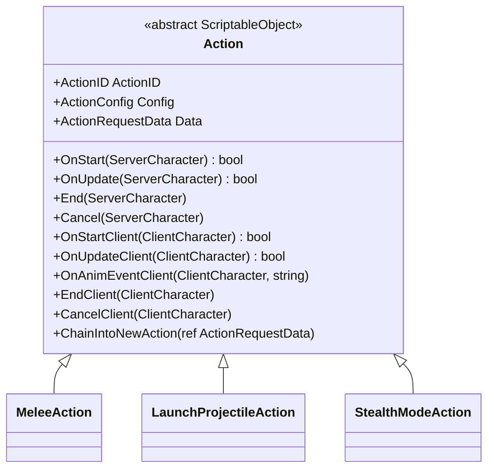
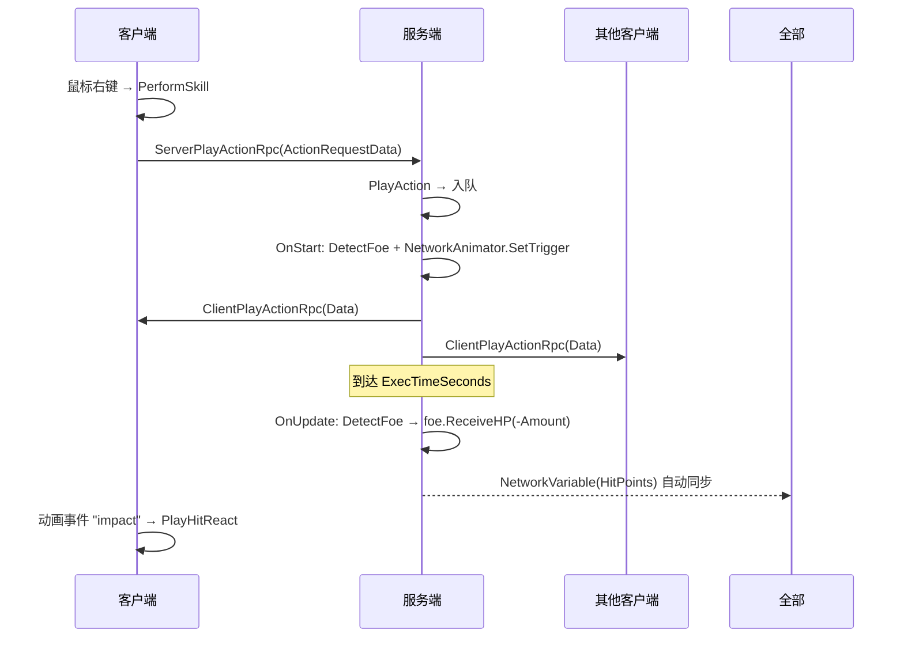

# 05 · 动作系统（Action System）

> 读完你应该能回答：
> - 为什么要把"技能"做成 ScriptableObject？策划改数值为什么不用改代码？
> - 服务端和客户端如何共用一个 `MeleeAction` 类却跑不同的逻辑？
> - `ServerActionPlayer` 的"阻塞队列 + 非阻塞列表"是怎么工作的？为什么要合成 Chase/Target 动作？
> - 一次"右键攻击"在网络上到底发了几条消息？

---

## 1. 设计目标

Boss Room 有 15 种左右的动作：近战、弓箭、火球、冲锋、嘲讽、隐身、复活、拾取、投掷……它们的共同点：

- 都有**前摇/执行/后摇**（`ExecTimeSeconds`、`DurationSeconds`、`EffectDurationSeconds`）；
- 都有**冷却**（`ReuseTimeSeconds`）；
- 都需要**服务端权威**（不能被客户端改伤害）；
- 都需要**客户端即时表现**（不能等服务端往返才播动画）。

如果每种技能写一个 `MonoBehaviour`，会出现大量重复。Boss Room 的抽象是：

> **动作 = 逻辑（服务端）+ 表现（客户端）+ 配置（ScriptableObject）**



**关键**：服务端和客户端方法在同一个类里，但**永远不会在同一个进程里同时被调用**（服务端调 `OnStart`，客户端调 `OnStartClient`）。这让"同一个技能的服务端规则和客户端表现"放在一个文件里，改的时候不会漏。

---

## 2. `ActionConfig`：所有可调参数

文件：`Assets/Scripts/Gameplay/Action/ActionConfig.cs`

| 字段 | 含义 |
| --- | --- |
| `Logic` (`ActionLogic` 枚举) | 技能类型，用于 UI 和通用逻辑分支（如 `Melee`、`LaunchProjectile`） |
| `Amount` | 伤害/治疗量，含义由具体 Action 决定 |
| `ManaCost` | 蓝耗 |
| `Range` | 施法/攻击距离 |
| `DurationSeconds` | 总时长（含前摇后摇） |
| `ExecTimeSeconds` | **执行时刻**（伤害在第几秒结算） |
| `EffectDurationSeconds` | 效果持续时间（buff/debuff） |
| `ReuseTimeSeconds` | 冷却 |
| `AnimAnticipation` | 客户端预测时先播的"预备"动画 |
| `Anim` / `Anim2` | 主/辅 Animator Trigger 名 |
| `ReactAnim` | 受击者播放的反应动画 |
| `OtherAnimatorVariable` | 额外 Animator 变量名（蓄力层数等） |
| `SplashDamage` / `KnockbackSpeed` / `KnockbackDuration` / `Radius` | 范围伤害 / 击退强度 / 击退时长 / 作用半径 |
| `MoveSpeed` | 位移类技能速度 |
| `ActionInput` | 可选的 `BaseActionInput` 子类（蓄力、拖拽瞄准等） |
| `ActionInterruptible` | 移动能否打断 |
| `IsInterruptableBy` | 哪些动作能打断我（配合 `CanBeInterruptedBy`） |
| `BlockingMode` | `Always` / `OnlyDuringExecTime`（何时变成非阻塞） |
| `Projectiles` / `Spawns` | 生成的投射物/对象 |
| `IsFriendly` | 是否友方技能（影响可命中目标） |
| `Icon` / `DisplayedName` / `Description` | UI 展示信息 |

> 配置是 `ScriptableObject`，所以**联机双方必须用同一份资源**。这也是"只发 `ActionID`（整数）"的前提：ID 是按 `GameDataSource` 里的顺序运行时生成的，双方一致即可。

---

## 3. `ActionRequestData`：网络上传递的"意图"

文件：`Assets/Scripts/Gameplay/Action/Input/ActionRequestData.cs`

一次动作请求需要带的信息：

```csharp
public struct ActionRequestData : INetworkSerializable
{
    public ActionID ActionID;
    public Vector3 Position;      // 技能中心点
    public Vector3 Direction;     // 朝向
    public ulong[] TargetIds;     // 目标 NetworkObjectId
    public float Amount;          // 通用数值（如 Chase 的目标距离）
    public bool ShouldQueue;      // true=排队；false=打断当前动作立即执行
    public bool ShouldClose;      // true=服务端先合成一个 ChaseAction 靠近目标
    public bool CancelMovement;   // true=施法前停止移动
}
```

### 3.1 位标记压缩（很值得学）

如果每个字段都序列化，一条"普通近战"请求要发 `Vector3 + Vector3 + 数组 + float + 3 个 bool`，接近 40 字节。实际大部分字段是默认值。于是：

```csharp
[Flags] private enum PackFlags : byte
{
    None = 0, HasPosition = 1, HasDirection = 1 << 1, HasTargetIds = 1 << 2,
    HasAmount = 1 << 3, ShouldQueue = 1 << 4, ShouldClose = 1 << 5, CancelMovement = 1 << 6
}

public void NetworkSerialize<T>(BufferSerializer<T> serializer)
{
    PackFlags flags = serializer.IsReader ? PackFlags.None : GetPackFlags();
    serializer.SerializeValue(ref ActionID);
    serializer.SerializeValue(ref flags);        // 1 字节

    if ((flags & PackFlags.HasPosition)  != 0) serializer.SerializeValue(ref Position);
    if ((flags & PackFlags.HasDirection) != 0) serializer.SerializeValue(ref Direction);
    if ((flags & PackFlags.HasTargetIds) != 0) serializer.SerializeValue(ref TargetIds);
    if ((flags & PackFlags.HasAmount)    != 0) serializer.SerializeValue(ref Amount);
}
```

效果：
- 无目标的近战：`ActionID(4) + flags(1) + Position(12) + Direction(12) ≈ 29 字节`
- 带目标的技能：额外加 `TargetIds`
- 三个 bool 全部塞进 1 个字节

注释也提醒：**`PackFlags` 是 `byte`，最多 8 个标记，加第 9 个字段时要改成 `ushort`/`uint`**。

### 3.2 `Compare`

`Compare(ref rhs)` 判断两个请求是否"功能等价"（忽略排队/靠近标志）。当前版本里没有调用点，属于留给扩展的工具方法（例如你想做"重复请求去重"时可以用）。

---

## 4. `ActionFactory`：每个 ActionID 一个对象池

文件：`Assets/Scripts/Gameplay/Action/ActionFactory.cs`

```csharp
private static Dictionary<ActionID, ObjectPool<Action>> s_ActionPools;

static ObjectPool<Action> GetActionPool(ActionID actionID)
{
    if (!s_ActionPools.TryGetValue(actionID, out var pool))
    {
        pool = new ObjectPool<Action>(
            createFunc: () => Object.Instantiate(GameDataSource.Instance.GetActionPrototypeByID(actionID)),
            actionOnRelease: action => action.Reset(),
            actionOnDestroy: Object.Destroy);
        s_ActionPools.Add(actionID, pool);
    }
    return pool;
}

public static Action CreateActionFromData(ref ActionRequestData data)
{
    var ret = GetActionPool(data.ActionID).Get();
    ret.Initialize(ref data);   // 记录 Data + ActionID
    return ret;
}
```

- `Action` 是 `ScriptableObject`，但这里 `Instantiate` 出的是**运行时副本**，可以持有状态（`m_ExecutionFired` 等）；
- `Reset()` 在归还池时清理状态，避免下次复用时残留；
- 池是**按 ActionID 分开的**，因为不同 Action 类型不能互换（`MeleeAction` 不能当 `StealthModeAction` 用）。

> 对比：`NetworkObjectPool`（[01](01-启动与依赖注入.md)）池化的是网络对象；`ActionFactory` 池化的是**逻辑对象**，两者解决的是不同层面的 GC 问题。

---

## 5. 服务端：`ServerActionPlayer`

文件：`Assets/Scripts/Gameplay/Action/ActionPlayers/ServerActionPlayer.cs`

### 5.1 两个容器

```csharp
private List<Action> m_Queue;               // 阻塞动作队列（只有队首在跑）
private List<Action> m_NonBlockingActions;  // 非阻塞动作（可以并行跑，比如飞行中的投射物）
```

**为什么要分两个**：
- 一个"技能"通常要独占角色（播放动画、锁朝向），所以同一时刻只能有一个 blocking action；
- 但"火球已经飞出去了"不该阻塞玩家继续行动，所以执行完 `ExecTimeSeconds` 后可以转为 non-blocking，让后续动作入队。

### 5.2 入队：`PlayAction`

```csharp
public void PlayAction(ref ActionRequestData action)
{
    // 1. 若当前动作可被打断，且新动作要求立即执行 → 清空队列
    if (!action.ShouldQueue && m_Queue.Count > 0 &&
        (m_Queue[0].Config.ActionInterruptible || m_Queue[0].Config.CanBeInterruptedBy(action.ActionID)))
        ClearActions(false);

    // 2. 队列深度限制：1.6 秒
    if (GetQueueTimeDepth() >= k_MaxQueueTimeDepth) return;   // 丢弃

    // 3. 创建动作并入队；若队列原本为空，立即开始
    var newAction = ActionFactory.CreateActionFromData(ref action);
    m_Queue.Add(newAction);
    if (m_Queue.Count == 1) StartAction();
}
```

`k_MaxQueueTimeDepth = 1.6f` 是个很实用的防刷设计：**按"执行时间"而不是"动作个数"限制队列**，避免玩家狂点把队列塞满、导致响应延迟。

### 5.3 启动时的"合成动作"

`StartAction()` 里有两个魔法：`SynthesizeTargetIfNecessary` 和 `SynthesizeChaseIfNecessary`。

**合成 TargetAction**：如果技能带单一目标，但角色的当前 `TargetId` 不是它，就插入一个 `GeneralTargetAction`，把角色朝向/目标切过去：

```csharp
ActionRequestData data = new ActionRequestData {
    ActionID = GameDataSource.Instance.GeneralTargetActionPrototype.ActionID,
    TargetIds = baseAction.Data.TargetIds
};
m_Queue.Insert(baseIndex, ActionFactory.CreateActionFromData(ref data));
```

**合成 ChaseAction**：如果 `ShouldClose == true`（右键远处敌人），先插入一个"追到攻击距离"的动作：

```csharp
ActionRequestData data = new ActionRequestData {
    ActionID = GameDataSource.Instance.GeneralChaseActionPrototype.ActionID,
    TargetIds = baseAction.Data.TargetIds,
    Amount = baseAction.Config.Range       // 追到"施法距离"为止
};
baseAction.Data.ShouldClose = false;       // 只合成一次
```

> 这是"动作组合"的漂亮用法：**追击、转向本身就是动作**，不需要在每个技能里写一遍"先跑过去再打"。

### 5.4 主循环：`OnUpdate`

由 `ServerCharacter.Update()` 每帧调用：

```csharp
public void OnUpdate()
{
    if (m_HasPendingSynthesizedAction) { ... PlayAction(ref m_PendingSynthesizedAction); }

    if (m_Queue.Count > 0 && m_Queue[0].ShouldBecomeNonBlocking())
    {
        m_NonBlockingActions.Add(m_Queue[0]);   // 转为非阻塞
        AdvanceQueue(false);
    }

    if (m_Queue.Count > 0) { ... 调用 OnUpdate ... }
    ... 遍历 m_NonBlockingActions 调用 OnUpdate ...
}
```

`ShouldBecomeNonBlocking()` 默认实现：

```csharp
return Config.BlockingMode == BlockingModeType.OnlyDuringExecTime
    ? TimeRunning >= Config.ExecTimeSeconds
    : false;
```

即"伤害结算完就不再阻塞"。

### 5.5 结束与回收

```csharp
private void AdvanceQueue(bool endRemoved)
{
    if (endRemoved)
    {
        m_Queue[0].End(m_ServerCharacter);
        if (m_Queue[0].ChainIntoNewAction(ref m_PendingSynthesizedAction))  // 比如"连招"
            m_HasPendingSynthesizedAction = true;
    }
    var action = m_Queue[0];
    m_Queue.RemoveAt(0);
    TryReturnAction(action);       // 归还对象池（但若还在非阻塞列表里则不还）
    ...
}
```

`TryReturnAction` 的检查很重要：一个动作可能同时还在 `m_NonBlockingActions` 里跑（比如投射物），此时**不能**归还池。

---

## 6. 客户端：`ClientActionPlayer`

文件：`Assets/Scripts/Gameplay/Action/ActionPlayers/ClientActionPlayer.cs`

```csharp
private const float k_AnticipationTimeoutSeconds = 1;
private List<Action> m_PlayingActions;
```

### 6.1 两种播放路径

1. **服务端广播**（权威）：`ClientPlayActionRpc(ActionRequestData)` → `PlayAction(ref data)`；
2. **本地预测**（仅 host 之外的 owner）：`ClientInputSender.ActionInputEvent` → `AnticipateAction(ref data)`。

```csharp
public void AnticipateAction(ref ActionRequestData data)
{
    if (!ClientCharacter.IsAnimating() && Action.ShouldClientAnticipate(ClientCharacter, ref data))
    {
        var actionFX = ActionFactory.CreateActionFromData(ref data);
        actionFX.AnticipateActionClient(ClientCharacter);
        m_PlayingActions.Add(actionFX);
    }
}
```

`Action.ShouldClientAnticipate`（`Action.cs:255`）的判定条件：

```csharp
if (!clientCharacter.CanPerformActions) return false;

// ShouldClose 的动作先在本地做一次距离检查：
// 不在范围内就不预测，因为服务端会先合成一个 ChaseAction 跑过来
if (data.ShouldClose) { ... isTargetEligible = dist^2 < range^2; }

// 除了 Target 动作之外，所有动作都支持预测
return isTargetEligible && actionDescription.Logic != ActionLogic.Target;
```

> 所以预测不是"只对攻击动作"，而是**默认全部支持、逐个动作可选实现**（`AnticipateActionClient` 可以什么都不做）。

### 6.2 预测如何被"扶正"或"丢弃"

服务端确认后，`PlayAction` 按 `ActionID` 找**已预测**的实例复用，而不是新建：

```csharp
public void PlayAction(ref ActionRequestData data)
{
    var anticipatedActionIndex = FindAction(data.ActionID, anticipatedOnly: true);
    var actionFX = anticipatedActionIndex >= 0
        ? m_PlayingActions[anticipatedActionIndex]
        : ActionFactory.CreateActionFromData(ref data);

    if (actionFX.OnStartClient(ClientCharacter))
    {
        if (anticipatedActionIndex < 0) m_PlayingActions.Add(actionFX);  // 新动作
        // 否则直接沿用已预测的实例
    }
    else if (anticipatedActionIndex >= 0)
    {
        // 服务端说不能播 → 丢弃预测
        m_PlayingActions.RemoveAt(anticipatedActionIndex);
        ActionFactory.ReturnAction(actionFX);
    }
}
```

**超时保护**：预测出来的动作如果 1 秒内没等到服务端确认，会被当作超时处理：

```csharp
bool timedOut = action.AnticipatedClient && action.TimeRunning >= k_AnticipationTimeoutSeconds;
if (timedOut) { action.CancelClient(ClientCharacter); }  // 注意：超时不调用 EndClient
```

> 这就是官方注释里说的 "Anticipated Actions 是机会主义的，不保证成功"——可能被服务端拒绝（队列满、目标死亡），所以必须有超时兜底。

### 6.3 动画事件驱动表现

客户端表现和动画是**对齐**的：`Animator` 上的 Animation Event 会调用

```csharp
// ClientCharacter 上挂的脚本转发
m_ClientActionViz.OnAnimEvent(id);
```

`MeleeAction.OnAnimEventClient` 收到 `"impact"` 才播受击者的 hit react——**表现时机由美术在动画里打点决定**，而不是硬编码时间。

### 6.4 取消

```csharp
public void CancelAllActions() { ... }
public void CancelAllActionsWithSamePrototypeID(ActionID id) { ... }
```

对应服务端 RPC：`ClientCancelAllActionsRpc` / `ClientCancelActionsByPrototypeIDRpc`。

---

## 7. 案例：`MeleeAction` 完整拆解

文件：`Assets/Scripts/Gameplay/Action/ConcreteActions/MeleeAction.cs` + `MeleeAction.Client.cs`（`partial class`）

### 7.1 服务端 `OnStart`

```csharp
public override bool OnStart(ServerCharacter serverCharacter)
{
    ulong target = Data.TargetIds?.Length > 0 ? Data.TargetIds[0] : serverCharacter.TargetId.Value;
    IDamageable foe = DetectFoe(serverCharacter, target);
    if (foe != null)
    {
        m_ProvisionalTarget = foe.NetworkObjectId;
        Data.TargetIds = new ulong[] { foe.NetworkObjectId };   // 把"猜测的目标"写进 Data
    }

    if (Data.Direction != Vector3.zero)
        serverCharacter.physicsWrapper.Transform.forward = Data.Direction;

    serverCharacter.serverAnimationHandler.NetworkAnimator.SetTrigger(Config.Anim);
    serverCharacter.clientCharacter.ClientPlayActionRpc(Data);  // ← 广播给所有客户端
    return true;
}
```

注意：**动画是服务端触发 `NetworkAnimator` 同步的**，而"动作开始"是通过自定义 RPC 广播的。两条通道各管各的。

### 7.2 服务端 `OnUpdate`：在 `ExecTimeSeconds` 结算

```csharp
public override bool OnUpdate(ServerCharacter clientCharacter)
{
    if (!m_ExecutionFired && (Time.time - TimeStarted) >= Config.ExecTimeSeconds)
    {
        m_ExecutionFired = true;
        var foe = DetectFoe(clientCharacter, m_ProvisionalTarget);   // 再次检测
        if (foe != null) foe.ReceiveHP(clientCharacter, -Config.Amount);
    }
    return true;
}
```

### 7.3 为什么检测两次？

源码注释（`MeleeAction.cs:11-30`）把这个权衡讲得非常透彻，值得完整读一遍。摘要：

| 方案 | 优点 | 缺点 |
| --- | --- | --- |
| 只在 `Start` 检测 | 简单、一次物理查询 | **不公平**：挥刀瞬间走出范围也会被打中，反之"走进刀口"反而不受伤 |
| 只在 `Update` 检测 + 单独 RPC 通知受击者 | 行为正确 | 多一条 RPC；客户端开始播动画时还不知道目标是谁，命中反馈和动画对不齐 |
| **两次都检测（本项目）** | 公平 + 能给对的受击者播反应 | 客户端要做"范围校验"，首次目标只是 hint |

客户端侧对应实现（`MeleeAction.Client.cs:94`）：

```csharp
void PlayHitReact(ClientCharacter parent)
{
    if (m_ImpactPlayed) return;
    m_ImpactPlayed = true;
    if (NetworkManager.Singleton.IsServer) return;     // 服务端不需要表现

    // 原始目标还在范围内？→ 播 hit react
    if (Data.TargetIds?.Length > 0 &&
        SpawnedObjects.TryGetValue(Data.TargetIds[0], out var target) &&
        (parent.transform.position - targetPos).sqrMagnitude < (Config.Range + k_RangePadding)^2)
    {
        animator.SetTrigger(Config.ReactAnim ?? k_DefaultHitReact);
    }
}
```

`k_RangePadding = 3f` 是"宽容距离"：客户端位置有插值误差，不能让玩家看到"明明打中了却没反应"。

### 7.4 一次右键攻击的消息流



**消息数量**（一次近战）：
- 1 条 `ServerPlayActionRpc`（客户端 → 服务端）
- 1 条 `ClientPlayActionRpc`（服务端 → 所有客户端，含 host）
- 1 条 `NetworkAnimator` 的 trigger 同步
- `NetworkVariable<int>` 的 HP 变化（Netcode 自动合并/压缩）

---

## 8. 新增一个动作的步骤

1. 新建 `class MyAction : Action`（逻辑复杂就加 `MyAction.Client.cs` partial）；
2. 实现 `OnStart` / `OnUpdate` / `End`（客户端对应 `OnStartClient` / `OnAnimEventClient`）；
3. 右键菜单 `Create > BossRoom > Actions > ...` 创建 SO，填 `ActionConfig`；
4. 把 SO 拖进 `GameDataSource` 的 `m_ActionPrototypes`；
5. 在 `CharacterClass` 里配置哪个职业能用（`Skill1/Skill2...`）；
6. 若需要特殊输入（蓄力、拖拽），实现 `BaseActionInput` 子类并挂到 `Config.ActionInput`。

> **不用改网络代码**：`ActionID` 自动分配、`ActionRequestData` 已包含通用字段、RPC 是通用的。

---

## 9. 常见坑

| 坑 | 说明 |
| --- | --- |
| 在 `Action` 里缓存 `ServerCharacter` 引用 | Action 会被池化复用，必须用参数传入，或在 `Reset()` 里清空 |
| `OnStart` 返回 `false` | 表示"这个动作不执行了"，此时**不会**调用 `End`，要自己清理 |
| 在客户端改 `Data` | `Data` 是引用（`ref`），服务端发来的数据是权威的；客户端只读 |
| 忘记 `NetworkAnimator` | 只播本地 Animator 的话，其他玩家看不到动画 |
| `ShouldQueue = false` 却没设置 `ActionInterruptible` | 新动作不会打断旧动作，会排队，手感很怪 |

---

## 10. 本章练习

1. **加一个"治疗术"**：`HealAction`，`IsFriendly = true`，`OnStart` 给自己/队友加 HP。观察"友好动作不做预测"的效果。
2. **改近战为"只在 Update 检测"**：删掉 `OnStart` 里的 `DetectFoe`，观察命中手感变化（这就是注释里方案 1 的缺点）。
3. **加一个可打断标记**：给 `ChargedShieldAction` 配置 `CanBeInterruptedBy`，测试被近战打断。
4. **观察带宽**：开 NetworkStats，对比"右键近战"和"火球"的 RPC 字节数，验证 `PackFlags` 的效果。

---

上一章：[04-场景与游戏状态](04-场景与游戏状态.md) ｜ 下一章：[06-角色-移动-战斗同步](06-角色-移动-战斗同步.md)
