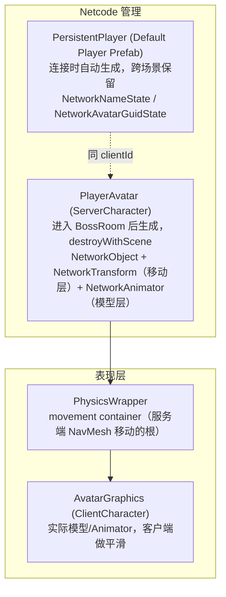

# 06 · 角色、移动与战斗同步

> 读完你应该能回答：
> - 一个玩家在场景里到底是几个 GameObject？`PersistentPlayer` / `Avatar` / `AvatarGraphics` 分别是什么？
> - 移动为什么是"客户端发目标点、服务端跑 NavMesh"？位置又是怎么同步回去的？
> - 伤害从命中到血条变化，中间经过哪些类？
> - AI 和刷怪器是怎么接进这套动作系统的？

---

## 1. 玩家对象的层级结构

这是理解 Boss Room 同步机制的**前提**。一个玩家连上后，场景里其实有两套对象：



| 对象 | 生命周期 | 职责 |
| --- | --- | --- |
| `PersistentPlayer` | 从连接到断开，**跨场景** | 保存玩家身份：名字、Avatar GUID。它由 `ConnectionApprovalResponse.CreatePlayerObject = true` 自动生成 |
| `PlayerAvatar`（带 `ServerCharacter`） | 进入 BossRoom 时生成 | 战斗实体：HP、动作、移动、AI（如果是 NPC） |
| `PhysicsWrapper` | 同上 | 提供"真正移动的 Transform"和伤害碰撞体的引用（根 GameObject 本身不移动，见其类注释） |
| `AvatarGraphics`（带 `ClientCharacter`） | 同上 | 纯客户端表现：动画、特效、平滑、相机 |

**为什么拆两层**：
- 服务端移动用 `NavMeshAgent` 直接改 `PhysicsWrapper` 的 Transform；
- 客户端模型需要做插值和平滑，不能直接跟服务端位置硬切；
- 名字/Avatar 这类"跨场景不变"的信息放在 `PersistentPlayer`，避免换场景重传。

---

## 2. `ServerCharacter`：服务端的"大脑外壳"

文件：`Assets/Scripts/Gameplay/GameplayObjects/Character/ServerCharacter.cs`

### 2.1 网络状态

```csharp
public NetworkVariable<MovementStatus> MovementStatus;   // Idle/Normal/Uncontrolled/Slowed/Hasted/Walking
public NetworkVariable<ulong> HeldNetworkObject;         // 手里拿的东西
public NetworkVariable<bool> IsStealthy;                 // 隐身
public NetworkVariable<ulong> TargetId;                  // 当前目标
NetworkLifeState NetLifeState;                            // LifeState (Alive/Fainted/Dead)
NetworkHealthState NetHealthState;                        // HitPoints
NetworkAvatarGuidState m_State;                           // 外观
```

注意：**这些是"状态"，不是"事件"**。Netcode 的 `NetworkVariable` 保证最终一致，但会有延迟；事件类信息（"谁打了谁"）走 RPC 或消息通道。

### 2.2 生命周期

```csharp
void Awake()
{
    m_ServerActionPlayer = new ServerActionPlayer(this);
    NetLifeState   = GetComponent<NetworkLifeState>();
    NetHealthState = GetComponent<NetworkHealthState>();
    m_State        = GetComponent<NetworkAvatarGuidState>();
}

public override void OnNetworkSpawn()
{
    if (!IsServer) { enabled = false; }    // 客户端上这个组件直接禁用
    else
    {
        NetLifeState.LifeState.OnValueChanged += OnLifeStateChanged;
        m_DamageReceiver.DamageReceived += ReceiveHP;
        m_DamageReceiver.CollisionEntered += CollisionEntered;

        if (IsNpc) m_AIBrain = new AIBrain(this, m_ServerActionPlayer);

        if (m_StartingAction != null) { ... PlayAction(...); }
        InitializeHitPoints();
    }
}
```

**`if (!IsServer) enabled = false;`** 是全项目反复出现的模式：服务端逻辑组件在客户端**直接关掉**，避免"客户端也跑一遍伤害计算"。

### 2.3 三个客户端 → 服务端的 RPC

```csharp
[Rpc(SendTo.Server)]
public void ServerSendCharacterInputRpc(Vector3 movementTarget)   // 移动

[Rpc(SendTo.Server)]
public void ServerPlayActionRpc(ActionRequestData data)           // 放技能

[Rpc(SendTo.Server)]
public void ServerStopChargingUpRpc()                             // 蓄力结束
```

移动 RPC 里有一层"打断"逻辑：

```csharp
if (LifeState == LifeState.Alive && !m_Movement.IsPerformingForcedMovement())
{
    // 当前动作可被打断？→ 清空
    if (m_ServerActionPlayer.GetActiveActionInfo(out ActionRequestData data) &&
        GameDataSource.Instance.GetActionPrototypeByID(data.ActionID).Config.ActionInterruptible)
        m_ServerActionPlayer.ClearActions(false);

    m_ServerActionPlayer.CancelRunningActionsByLogic(ActionLogic.Target, true);  // 移动时清目标
    m_Movement.SetMovementTarget(movementTarget);
}
```

> 这就是"移动打断施法"的实现位置——**在服务端**，客户端无法绕过。

### 2.4 伤害入口：`ReceiveHP`

```csharp
void ReceiveHP(ServerCharacter inflicter, int HP)
{
    if (HP > 0)  { /* 治疗：Buff 修正 */ }
    else
    {
        if (NetLifeState.IsGodMode.Value) return;           // 仅编辑器/Dev
        m_ServerActionPlayer.OnGameplayActivity(Action.GameplayActivity.AttackedByEnemy);
        HP = (int)(HP * m_ServerActionPlayer.GetBuffedValue(Action.BuffableValue.PercentDamageReceived));
        serverAnimationHandler.NetworkAnimator.SetTrigger("HitReact1");
    }

    HitPoints = Mathf.Clamp(HitPoints + HP, 0, CharacterClass.BaseHP.Value);

    if (m_AIBrain != null) m_AIBrain.ReceiveHP(inflicter, HP);   // 让 AI 记住仇人

    if (HitPoints <= 0)
    {
        if (IsNpc) { ... Dead; StartCoroutine(KilledDestroyProcess()); }
        else       { LifeState = LifeState.Fainted; }            // 玩家倒下，可被复活
        m_ServerActionPlayer.ClearActions(false);
    }
}
```

**注意 `HitPoints = ...` 是给 `NetworkVariable` 赋值**，Netcode 会自动把变化同步给客户端，UI 的 `UIHealth` 订阅 `OnValueChanged` 更新血条。

### 2.5 复活

```csharp
public void Revive(ServerCharacter inflicter, int HP)
{
    if (LifeState == LifeState.Fainted)
    {
        HitPoints = Mathf.Clamp(HP, 0, CharacterClass.BaseHP.Value);
        NetLifeState.LifeState.Value = LifeState.Alive;
    }
}
```

### 2.6 每帧驱动

```csharp
void Update()
{
    m_ServerActionPlayer.OnUpdate();                                    // 动作系统
    if (m_AIBrain != null && LifeState == LifeState.Alive && m_BrainEnabled)
        m_AIBrain.Update();                                            // AI
}
```

> 只有服务端会执行到这里（客户端 `enabled = false`）。

---

## 3. `ClientCharacter`：客户端的表现层

文件：`Assets/Scripts/Gameplay/GameplayObjects/Character/ClientCharacter.cs`

### 3.1 三个服务端 → 客户端的 RPC

```csharp
[Rpc(SendTo.ClientsAndHost)] public void ClientPlayActionRpc(ActionRequestData data)
[Rpc(SendTo.ClientsAndHost)] public void ClientCancelAllActionsRpc()
[Rpc(SendTo.ClientsAndHost)] public void ClientCancelActionsByPrototypeIDRpc(ActionID id)
[Rpc(SendTo.ClientsAndHost)] public void ClientStopChargingUpRpc(float percentCharged)
```

`SendTo.ClientsAndHost` 表示"所有客户端 + host 自己"，host 也要播表现（因为 host 也是玩家）。

### 3.2 平滑：为什么要手动 lerp

```csharp
const float k_LerpTime = 0.08f;

void Update()
{
    // On the host, Characters are translated via ServerCharacterMovement's FixedUpdate method.
    // To ensure that the game camera tracks a GameObject moving in the Update loop and therefore eliminate
    // any camera jitter, this graphics GameObject's position is smoothed over time on the host.
    // Clients do not need to perform any positional smoothing since NetworkTransform will interpolate
    // position updates on the root GameObject.
    if (IsHost)
    {
        m_LerpedPosition = m_PositionLerper.LerpPosition(m_LerpedPosition, serverCharacter.physicsWrapper.Transform.position);
        m_LerpedRotation = m_RotationLerper.LerpRotation(m_LerpedRotation, serverCharacter.physicsWrapper.Transform.rotation);
        transform.SetPositionAndRotation(m_LerpedPosition, m_LerpedRotation);
    }
    ...
}
```

**这段注释解释了一个经典问题**：
- **客户端**：角色预制体上有 `NetworkTransform`（同步"移动容器"那层 Transform），Netcode 自己做插值；
- **Host**：服务端在 `FixedUpdate` 里移动（物理帧率），但相机在 `Update` 里跟随（渲染帧率），两者不同步会导致相机抖动。所以在 host 上给模型加一层 0.08s 的平滑。

### 3.3 动画参数

```csharp
void OnMovementStatusChanged(MovementStatus previous, MovementStatus newValue)
    => m_CurrentSpeed = GetVisualMovementSpeed(newValue);
```

`MovementStatus` 是 `NetworkVariable`，变化时把对应速度写进 Animator 的 `Speed` 参数（`SpeedIdle/Normal/Uncontrolled/Slowed/Hasted/Walking` 来自 `VisualizationConfiguration`）。

### 3.4 隐身外观

```csharp
void SetAppearanceSwap()
{
    var mode = CharacterSwap.SpecialMaterialMode.None;
    if (m_ServerCharacter.IsStealthy.Value)
        mode = m_ServerCharacter.IsOwner ? StealthySelf : StealthyOther;
    m_CharacterSwapper.SwapToModel(mode);
}
```

**"自己隐身"和"别人隐身"用不同材质**——这是游戏性需求（自己要看得到自己），纯表现层逻辑，不需要同步。

### 3.5 动画事件

```csharp
void OnAnimEvent(string id)   // 由 Animation Event 通过字符串调用（"magic"）
{
    m_ClientActionViz.OnAnimEvent(id);
}
```

> 这个方法的调用方是 Unity 的 Animation Event 系统（在动画剪辑里配置的方法名），所以搜索不到调用点，注释专门说明了。

---

## 4. 移动：客户端发目标点，服务端跑 NavMesh

### 4.1 客户端采集

`ClientInputSender.FixedUpdate`（`Gameplay/UserInput/ClientInputSender.cs:249`）：

```csharp
if (m_MoveRequest)
{
    m_MoveRequest = false;
    if ((Time.time - m_LastSentMove) > k_MoveSendRateSeconds)   // 0.04s ≈ 25Hz
    {
        m_LastSentMove = Time.time;
        var ray = m_MainCamera.ScreenPointToRay(Input.mousePosition);
        var groundHits = Physics.RaycastNonAlloc(ray, k_CachedHit, k_MouseInputRaycastDistance, m_GroundLayerMask);

        if (groundHits > 0 && NavMesh.SamplePosition(k_CachedHit[0].point, out var hit, k_MaxNavMeshDistance, NavMesh.AllAreas))
        {
            m_ServerCharacter.ServerSendCharacterInputRpc(hit.position);   // 只发目标点！
            ClientMoveEvent?.Invoke(hit.position);                         // 本地 UI/预测
        }
    }
}
```

三个关键点：
1. **发送的是"目标位置"，不是"每帧位移"**。带宽极低（一次 12 字节），且服务端可以用 NavMesh 处理绕障碍。
2. **限频 25Hz**：鼠标移动事件可能每帧都有，但没必要每帧发。
3. **`NavMesh.SamplePosition`**：保证目标点落在导航网格上，避免服务端寻路失败。

### 4.2 服务端执行

`ServerCharacterMovement.PerformMovement()`（`FixedUpdate` 调用）：

```csharp
if (m_MovementState == MovementState.Charging) { movementVector = transform.forward * speed * dt; }
else if (m_MovementState == MovementState.Knockback) { movementVector = m_KnockbackVector * speed * dt; }
else
{
    movementVector = m_NavPath.MoveAlongPath(GetBaseMovementSpeed() * dt);   // 沿动态路径走
    if (movementVector == Vector3.zero) { m_MovementState = Idle; return; }
}

m_NavMeshAgent.Move(movementVector);
transform.rotation = Quaternion.LookRotation(movementVector);
m_Rigidbody.position = transform.position;
```

`MovementState` 四种：`Idle / PathFollowing / Charging / Knockback`。

**"强制位移"不可打断**：

```csharp
public bool IsPerformingForcedMovement() => m_MovementState == Knockback || m_MovementState == Charging;
```

`ServerCharacter.PlayAction` 和 `ServerSendCharacterInputRpc` 都会检查它——被击退/冲锋时不能放技能也不能改方向。

### 4.3 位置怎么同步回客户端

`PlayerAvatar` 预制体上挂 **`NetworkTransform`**（挂在承担移动的那层 Transform 上，服务端权威），Netcode 在客户端做插值。所以：

- 服务端：`NavMeshAgent.Move` 改移动容器的 Transform；
- 客户端：`NetworkTransform` 把该 Transform 平滑到服务端位置；
- 模型子对象：跟随移动容器（host 额外做 0.08s 平滑，见 3.2）。

> **不要**再手动给角色加"位置 RPC"，那是重复劳动。Boss Room 只在"瞬移"场景需要特殊处理（`Teleport` 的注释说明：客户端会看到角色滑过去，所以 `DashAttackAction` 用自定义表现来掩盖）。

### 4.4 动态寻路

`NavigationSystem` + `DynamicNavPath`（`Assets/Scripts/Gameplay/Navigation/`）封装了 `NavMeshAgent` + `NavMeshObstacle` 的动态避障（门、可破坏物移动后重建路径）。这是 URP Demo 之外少见的"联网 + 动态寻路"实现，值得单独看。

---

## 5. 生命值 / 状态同步链路

```mermaid
flowchart LR
    A[MeleeAction.OnUpdate] -->|foe.ReceiveHP| B[ServerCharacter.ReceiveHP]
    B -->|HitPoints = x| C[NetworkHealthState.HitPoints<br/>NetworkVariable&lt;int&gt;]
    C -->|OnValueChanged| D[UIHealth 血条]
    C -->|previous>0 && new<=0| E[HitPointsDepleted 事件]
    E --> F[LifeState = Dead/Fainted]
    F -->|LifeState NetworkVariable| G[ClientCharacter: 播放死亡动画]
    F --> H[PublishMessageOnLifeChange → NetworkedMessageChannel]
    H --> I[ServerBossRoomState: 胜负判定]
    H --> J[UIMessageFeed: "xxx 倒下了"]
```

相关类：

| 类 | 文件 | 作用 |
| --- | --- | --- |
| `NetworkHealthState` | `GameplayObjects/NetworkHealthState.cs` | 只有一个 `NetworkVariable<int> HitPoints` +  depleted/replenished 事件 |
| `NetworkLifeState` | `GameplayObjects/NetworkLifeState.cs` | `LifeState`（Alive/Fainted/Dead）+ `IsGodMode` |
| `DamageReceiver` | `GameplayObjects/DamageReceiver.cs` | 实现 `IDamageable`，把 `ReceiveHP` 转成事件 |
| `IDamageable` | `GameplayObjects/IDamageable.cs` | 伤害接口（`ReceiveHP` / `IsDamageable` / `SpecialDamageFlags`） |
| `UIHealth` | `Gameplay/UI/UIHealth.cs` | 订阅 `NetworkVariable.OnValueChanged` 更新 Slider |
| `PublishMessageOnLifeChange` | `GameplayObjects/PublishMessageOnLifeChange.cs` | 监听 LifeState → 发布 `LifeStateChangedEventMessage` |

> **分层清晰**：`NetworkHealthState` 只负责"数值 + 变化事件"，不关心 UI，也不关心游戏结束。谁关心谁订阅。

---

## 6. AI：`AIBrain` + 状态机

文件：`Assets/Scripts/Gameplay/GameplayObjects/Character/AI/`

```csharp
public class AIBrain
{
    private enum AIStateType { ATTACK, IDLE }
    private Dictionary<AIStateType, AIState> m_Logics;   // 每个状态一个类
    private List<ServerCharacter> m_HatedEnemies;        // 仇恨列表

    public void Update()
    {
        AIStateType newState = FindBestEligibleAIState();   // 按顺序找第一个 eligible 的
        if (m_CurrentState != newState) m_Logics[newState].Initialize();
        m_CurrentState = newState;
        m_Logics[m_CurrentState].Update();
    }

    public void ReceiveHP(ServerCharacter inflicter, int amount)
    {
        if (inflicter != null && amount < 0) Hate(inflicter);   // 谁打我我记谁
    }
}
```

- `IdleAIState`：没敌人时待机/巡逻；
- `AttackAIState`：有敌人时追击 + 放技能，通过 `ServerActionPlayer` 走**和玩家完全相同的动作系统**；
- `IsAppropriateFoe`：排除 NPC、死亡、隐身的目标；
- `DetectRange` 可被刷怪器覆盖（`m_DetectRangeOverride`）。

**AI 不直接改 Transform**，它只调用 `PlayAction` / `SetMovementTarget`，所以"玩家和 AI 走同一套网络逻辑"。

---

## 7. 场景里的其他联网对象

| 对象 | 文件 | 同步方式 | 说明 |
| --- | --- | --- | --- |
| 可破坏物（木桶/罐子） | `Breakable.cs` | `NetworkVariable<bool> IsBroken` + `Collider` | 被打碎后变碎片 |
| 门 | `SwitchedDoor.cs` | `NetworkVariable<bool>` + `DoorStateChangedEventMessage` | 需要两个开关同时按下才开 |
| 地板开关 | `FloorSwitch.cs` | `NetworkVariable<bool>` | 玩家站上去触发 |
| 敌人传送门/刷怪 | `EnemyPortal.cs` + `ServerWaveSpawner.cs` | 服务端协程 + `NetworkObjectPool`/Spawn | 按波次刷怪，玩家靠近才启动 |
| 投射物 | `PhysicsProjectile.cs` / `FXProjectile.cs` | `NetworkObject` + `NetworkTransform`（父对象） | 服务端算物理，客户端跟随 |
| 拾取物 | `TossedItem.cs` / `PickUpState.cs` | `NetworkVariable` + 动作系统 | 需服务端验证归属 |

### 7.1 `ServerWaveSpawner` 的触发条件

```csharp
// 玩家必须靠近（且不被墙挡住）才开始刷怪
bool IsPlayerNearby()
{
    foreach (var serverCharacter in PlayerServerCharacter.GetPlayerServerCharacters())
    {
        if (!m_DetectStealthyPlayers && serverCharacter.IsStealthy.Value) continue;
        var direction = playerPosition - spawnerPosition;
        if (direction.sqrMagnitude > squaredProximityDistance) continue;

        var hit = Physics.RaycastNonAlloc(ray, m_Hit, Mathf.Min(direction.magnitude, m_ProximityDistance), m_BlockingMask);
        if (hit == 0) return true;    // 没有遮挡 = 看得见
    }
    return false;
}
```

还有"动态刷怪上限"：

```csharp
m_MinSpawnCap + ceil(玩家数 * m_SpawnCapIncreasePerPlayer)
```

即人数越多，同屏怪越多，但不超过 `m_MaxSpawnCap`。

---

## 8. 常见坑

| 坑 | 说明 |
| --- | --- |
| 在客户端 `ServerCharacter.enabled = true` | 会跑两套逻辑，伤害翻倍 |
| 直接改 `transform.position` 同步位置 | 用 `NetworkTransform`，别自己造轮子；瞬移要单独处理表现 |
| 用 `clientId` 做玩家标识 | 重连后 clientId 会变，用 playerId |
| 在 `OnNetworkSpawn` 前访问 `NetworkVariable.Value` | 读到默认值，用 `OnNetworkSpawn` 或先赋值再 Spawn |
| 服务端算完伤害却没同步表现 | `NetworkAnimator.SetTrigger` 只同步动画；特效/音效要自己发 RPC 或放 Action 里 |

---

## 9. 本章练习

1. **加一个"减速"效果**：在动作里设置 `MovementStatus = Slowed`，观察客户端动画速度变化（`GetVisualMovementSpeed`）。
2. **改移动发送频率**：把 `k_MoveSendRateSeconds` 从 0.04 改成 0.2，观察移动卡顿；再改成 0.01 观察带宽。
3. **关掉 host 平滑**：注释 `if (IsHost)` 分支，在 host 上快速移动并观察相机抖动，理解 FixedUpdate/Update 不一致的后果。
4. **给 AI 加"逃跑"状态**：新增 `FleeAIState`，HP 低于 30% 时后撤。体会 `AIState` 接口的 `IsEligible/Initialize/Update`。

---

上一章：[05-动作系统](05-动作系统.md) ｜ 下一章：[07-网络同步机制与工具](07-网络同步机制与工具.md)
