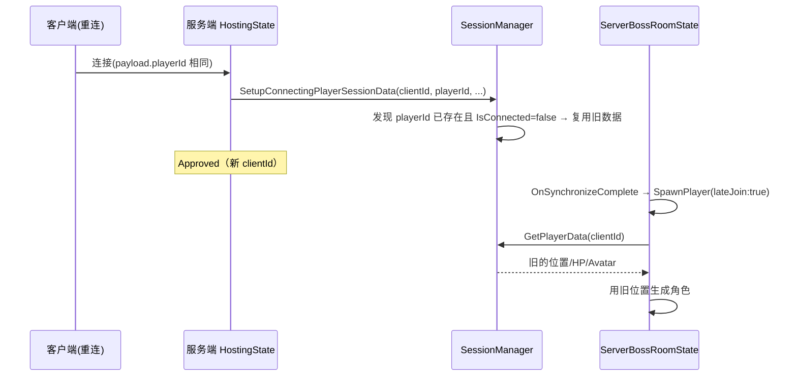

# 07 · 网络同步机制与工具

> 读完你应该能回答：
> - Netcode 的每个原语（NetworkVariable / RPC / NetworkList / named message / 场景管理）在这个项目里各自出现在哪、为什么？
> - `NetworkVariable` 的读写权限怎么控制？客户端能写吗？
> - 为什么有的消息走 RPC、有的走 named message、有的走本地事件？
> - `SessionManager` 如何支撑"断线重连保留进度"？

这一章是"横向总结"，把前几章用到的网络机制集中起来对照 Netcode 文档。

---

## 1. 一张对照表

| Netcode 原语 | 项目中的典型位置 | 用来传什么 | 为什么选它 |
| --- | --- | --- | --- |
| `NetworkVariable<T>` | `NetworkHealthState.HitPoints`、`ServerCharacter.MovementStatus`、`NetworkLifeState.LifeState`、`NetworkCharSelection.IsLobbyClosed` | 持续存在的状态（会反复变化、新加入者要能拿到当前值） | 自动同步 + 新客户端自动收到当前值 |
| `NetworkList<T>` | `NetworkCharSelection.LobbyPlayers` | 数量会变的列表 | 增量同步（Add/Remove/Set），带 `OnListChanged` |
| ServerRpc（`[Rpc(SendTo.Server)]`） | `ServerPlayActionRpc`、`ServerSendCharacterInputRpc`、`ServerChangeSeatRpc` | 客户端意图 | 点对点、低延迟、可带复杂结构 |
| ClientRpc（`[Rpc(SendTo.ClientsAndHost)]`） | `ClientPlayActionRpc`、`ClientCancelAllActionsRpc`、`ClientStopChargingUpRpc` | 服务端 → 全体的"事件" | 一次性广播，不需要保存状态 |
| Named Message | `NetworkedMessageChannel<T>` | 服务端 → 全体的业务事件（生死、连接） | 与 Netcode 对象无关、可跨场景、解耦 |
| 场景管理 | `SceneLoaderWrapper`、`ServerBossRoomState` | 游戏状态切换 | 保证客户端与服务端场景一致 |
| 连接审批 | `HostingState.ApprovalCheck` | 准入控制 | 唯一能在连接时拒绝的地方 |
| 对象池 / PrefabHandler | `NetworkObjectPool` | 高频生成物 | 避免 GC |
| `NetworkTransform` | 角色移动层、投射物 | 位置/旋转 | 服务端权威 + 客户端插值 |
| `NetworkAnimator` | 角色 Animator | 动画 trigger/参数 | 服务端触发、客户端播放 |

---

## 2. `NetworkVariable`：状态同步

### 2.1 读写权限

Netcode 默认**只有服务端能写** `NetworkVariable`（`WritePerm` 默认 `Server`）。项目里所有 `NetworkVariable` 都遵循这一点：

```csharp
HitPoints = ...;                       // 服务端写
MovementStatus.Value = currentState;   // 服务端写
IsLobbyClosed.Value = true;            // 服务端写
```

客户端只能读 + 订阅：

```csharp
m_ServerCharacter.IsStealthy.OnValueChanged += OnStealthyChanged;
```

> 如果确实需要客户端写（比如"玩家自己改自己的昵称"），可以 `new NetworkVariable<T>(default, NetworkVariableReadPermission.Everyone, NetworkVariableWritePermission.Owner)`。Boss Room 里名字走的是连接 payload + 服务端转发，没有用 owner write。

### 2.2 初始化时机陷阱

`NetworkVariable` 的初始值在 `OnNetworkSpawn` **之前**设置才不会丢。项目里有两个典型写法：

```csharp
// ✅ 生成前就构造好
networkAvatarGuidState.AvatarGuid = new NetworkVariable<NetworkGuid>(persistentPlayer.NetworkAvatarGuidState.AvatarGuid.Value);

// ✅ 字段初始化器 + 服务端在 OnNetworkSpawn 里赋值
public NetworkVariable<MovementStatus> MovementStatus { get; } = new NetworkVariable<MovementStatus>();
```

```csharp
// ❌ 错误：先生成再赋值，客户端 OnNetworkSpawn 里读到默认值
newPlayer.Spawn();
newPlayer.GetComponent<...>().AvatarGuid.Value = ...;
```

### 2.3 别把"事件"塞进 NetworkVariable

`NetworkVariable` 是**最终一致**的，不是"事件"。比如"谁打了谁"这种一次性信息，如果用 `NetworkVariable` 传，会：
- 丢失中间值（Netcode 会合并变化）；
- 新加入的客户端收到一个"过期的攻击"。

所以项目里事件走 RPC / named message，状态才走 `NetworkVariable`。

---

## 3. `NetworkList`：列表同步

```csharp
private NetworkList<LobbyPlayerState> m_LobbyPlayers;

private void Awake()
{
    m_LobbyPlayers = new NetworkList<LobbyPlayerState>();   // 必须在 Awake 构造
}
```

使用规则（踩坑高发区）：

| 操作 | 谁能做 | 注意 |
| --- | --- | --- |
| `Add / RemoveAt / Clear` | **只有服务端** | 客户端调用会报错 |
| `list[i] = value` | 只有服务端 | 结构体要正确实现 `Equals`，否则不会触发变更 |
| `OnListChanged` | 所有人 | 参数是 `NetworkListEvent<T>`，要处理 `Add/Remove/Value/Full` 等类型 |
| 遍历 | 所有人 | 不要在遍历时修改 |

`LobbyPlayerState` 实现了 `IEquatable<LobbyPlayerState>`，**这是必须的**：`NetworkList` 用 `Equals` 判断元素是否真的变了，不实现会导致"改了但不同步"或"每次都同步"。

另外注意结构体里用 `FixedPlayerName`（定长）而不是 `string`：`NetworkList` 的元素必须可序列化，`string` 每次都要分配。

---

## 4. RPC：三种 `SendTo`

项目里用到的三种：

```csharp
[Rpc(SendTo.Server)]                 public void ServerPlayActionRpc(ActionRequestData data)
[Rpc(SendTo.ClientsAndHost)]          public void ClientPlayActionRpc(ActionRequestData data)
[Rpc(SendTo.SpecifiedInParams)]       void ClientStopLoadingScreenRpc(RpcParams p = default)
```

| 模式 | 语义 | 项目位置 |
| --- | --- | --- |
| `SendTo.Server` | 客户端 → 服务端（owner 默认） | `ServerCharacter` 的三个输入 RPC |
| `SendTo.ClientsAndHost` | 服务端 → 所有客户端 + host 自己 | `ClientCharacter` 的表现 RPC |
| `SendTo.SpecifiedInParams` | 服务端 → 指定客户端 | `SceneLoaderWrapper` 关闭 loading 屏 |
| `RequireOwnership = false` | 非 owner 也能调用 | `ServerChangeSeatRpc`（CharSelect 时角色还不存在，没有 owner 概念） |

### 4.1 参数序列化

RPC 参数必须是 Netcode 能序列化的类型：
- 基础类型、`INetworkSerializable`（如 `ActionRequestData`）、`INetworkSerializeByMemcpy`（unmanaged）；
- `Vector3`、`FixedString` 等内置支持；
- **不支持** `List<T>` 以外的复杂引用类型（数组可以）。

### 4.2 RPC 不是"可靠有序"的万能药

Netcode 的 RPC 默认走可靠通道（reliable），但**顺序**只保证在同一通道内。项目里没有依赖"RPC 严格顺序"的地方——`ServerActionPlayer` 的队列本身就是顺序缓冲。

---

## 5. Named Message：与对象无关的广播

`NetworkedMessageChannel<T>` 底层：

```csharp
// 服务端 Publish
CustomMessagingManager.SendNamedMessageToAll(k_MessageName, writer);
// 客户端注册
CustomMessagingManager.RegisterNamedMessageHandler(k_MessageName, OnMessageReceived);
```

约束：

```csharp
where T : unmanaged, INetworkSerializeByMemcpy
```

即消息必须是**纯数据 struct**（不能有 `string`、引用类型）。项目里的消息：

| 消息 | 字段 |
| --- | --- |
| `LifeStateChangedEventMessage` | `CharacterType`、`CharacterName`（FixedString）、`NewLifeState` |
| `ConnectionEventMessage` | `ConnectStatus`、`PlayerName`（FixedString） |
| `CheatUsedMessage` | `CheatUsed`、`CheaterName` |

**为什么不用 RPC**：这些事件不属于某个 `NetworkObject`。用 named message 可以：
- 不依赖对象生命周期（玩家死了对象销毁了，消息还能发）；
- 跨场景（场景切换后 handler 还在）；
- 完全解耦（发送方不需要知道接收方是谁）。

> `FixedString` 的选择也是被迫的：`INetworkSerializeByMemcpy` 不允许托管字符串。

---

## 6. 对象生成：三种方式

| 方式 | 代码 | 用途 |
| --- | --- | --- |
| 连接时自动生成 | `ConnectionApprovalResponse.CreatePlayerObject = true` | `PersistentPlayer`（Default Player Prefab） |
| 手动 Spawn | `newPlayer.SpawnWithOwnership(clientId, destroyWithScene: true)` | 玩家 Avatar |
| 池化 Spawn | `NetworkObjectPool.Singleton.GetNetworkObject(prefab, pos, rot).Spawn()` | 投射物 |

### 6.1 `SpawnWithOwnership` 的第二个参数

```csharp
newPlayer.SpawnWithOwnership(clientId, true);
//                                            ↑ destroyWithScene
```

`true` 表示"场景卸载时自动销毁"。玩家 Avatar 属于 BossRoom 场景，切到 PostGame 时要销毁；而 `PersistentPlayer` 是 `false`（跨场景保留）。

### 6.2 池化对象的所有权

`NetworkObjectPool` 只负责"复用实例"，不改变所有权语义。投射物通常由服务端 Spawn（owner = server），因为伤害判定在服务端。

---

## 7. 场景管理

### 7.1 两种加载路径

```csharp
SceneLoaderWrapper.Instance.LoadScene("BossRoom", useNetworkSceneManager: true);
SceneLoaderWrapper.Instance.LoadScene("MainMenu", useNetworkSceneManager: false);
```

- **网络场景**：`NetworkManager.SceneManager.LoadScene`，服务端发起，客户端跟随，`OnSceneEvent` 提供每个客户端的加载进度。
- **本地场景**：`SceneManager.LoadSceneAsync`，用于"还没联网"的 MainMenu。

### 7.2 关键回调

| 回调 | 触发时机 | 项目用途 |
| --- | --- | --- |
| `OnLoad` | 开始加载 | loading 屏 |
| `OnLoadComplete` | 某客户端加载完 | CharSelect 分配座位 |
| `OnLoadEventCompleted` | **所有**客户端加载完（或超时） | BossRoom 首次生成玩家 |
| `OnSynchronizeComplete` | 某客户端完成场景同步 | 晚加入玩家生成 |

### 7.3 加载屏

`SceneLoaderWrapper` 里有个细节：

```csharp
case SceneEventType.SynchronizeComplete:
    // 服务端等自己处理完（比如生成了角色）再让指定客户端关 loading 屏
    ClientStopLoadingScreenRpc(RpcTarget.Group(new[] { sceneEvent.ClientId }, RpcTargetUse.Temp));
```

**为什么用 `SynchronizeComplete` 而不是 `LoadEventCompleted`**：客户端加载完场景后还要"同步"服务端已有的网络对象（包括服务端刚生成的玩家角色）。如果在 `LoadEventCompleted` 就关 loading，玩家会看到角色"凭空出现"。

---

## 8. `SessionManager<T>`：跨重连的玩家数据

文件：`Packages/com.unity.multiplayer.samples.coop/Utilities/Net/SessionManager.cs`

### 8.1 数据结构

```csharp
Dictionary<string, T> m_ClientData;          // playerId -> 数据
Dictionary<ulong, string> m_ClientIDToPlayerId;  // clientId -> playerId
bool m_HasSessionStarted;                    // 是否已开局（决定断线是否保留数据）
```

### 8.2 三阶段

| 方法 | 时机 | 行为 |
| --- | --- | --- |
| `SetupConnectingPlayerSessionData` | 连接审批通过 | 若是老 playerId 且未连接 → **复用旧数据**（重连）；否则新建 |
| `DisconnectClient` | 客户端断开 | `m_HasSessionStarted == true`：只标记 `IsConnected = false`（保留）；否则删除 |
| `OnSessionStarted` | 进入 BossRoom | 之后断线都保留数据 |
| `OnSessionEnded` | 回主菜单 | 清掉断线者数据 + `Reinitialize()`，下一局当新人 |
| `OnServerEnded` | 停服 | 全清 |

### 8.3 `SessionPlayerData`

```csharp
public struct SessionPlayerData : ISessionPlayerData
{
    public string PlayerName;
    public int PlayerNumber;
    public Vector3 PlayerPosition;
    public Quaternion PlayerRotation;
    public NetworkGuid AvatarNetworkGuid;
    public int CurrentHitPoints;
    public bool HasCharacterSpawned;
}
```

这些字段正是"重连后恢复现场"需要的：位置、朝向、外观、血量、是否已生成过角色。

### 8.4 重连时数据怎么被用



`ServerCharacter.InitializeHitPoints()` 也会读 `SessionPlayerData.CurrentHitPoints`：

```csharp
if (sessionPlayerData is { HasCharacterSpawned: true })
{
    HitPoints = sessionPlayerData.Value.CurrentHitPoints;
    if (HitPoints <= 0) LifeState = LifeState.Fainted;   // 重连时是倒地状态
}
```

---

## 9. 带宽与性能

### 9.1 这个项目做对的几件事

| 做法 | 收益 |
| --- | --- |
| 移动只发目标点（0.04s 一次） | 比每帧发位置省 90%+ |
| `ActionRequestData` 位标记压缩 | 一条动作请求 ~10-30 字节 |
| 投射物对象池 | 消除 Instantiate/Destroy 的 GC |
| `NetworkList` 而不是整个 List 的 NetworkVariable | 只同步变化的元素 |
| 用 `FixedString` 而不是 `string` | 无托管分配 |
| 状态用 `NetworkVariable`、事件用 RPC | 减少冗余重发 |

### 9.2 可以观察的地方

装 `Unity Multiplayer Tools` 后：
- **NetworkStats**：每个 RPC/NetworkVariable 的字节数；
- **NetworkProfiler**：按对象统计；
- **NetworkSimulator**：加延迟/丢包，观察预测与插值。

### 9.3 本项目**没有**做的

- 没有客户端预测移动（移动完全服务端权威，客户端靠 `NetworkTransform` 插值）；
- 没有 rollback / 帧同步；
- 没有兴趣管理（AOI），8 人小场景不需要。

> 这也是"合作 PvE"和"竞技 FPS"的架构差异：前者可以接受 100ms 的输入延迟，后者不行。

---

## 10. 与 Netcode 文档的对应关系

| 你读过的文档章节 | 项目中的落点 |
| --- | --- |
| NetworkObject / Spawn / Despawn | `ServerBossRoomState.SpawnPlayer`、`NetworkObjectPool` |
| NetworkVariable | `NetworkHealthState`、`ServerCharacter` |
| NetworkList | `NetworkCharSelection.LobbyPlayers` |
| RPC（Server/Client） | `ServerCharacter` / `ClientCharacter` |
| Custom Messaging | `NetworkedMessageChannel<T>` |
| Scene Management | `SceneLoaderWrapper`、`GameStateBehaviour` |
| Connection Approval | `HostingState.ApprovalCheck` |
| Transport / Relay | `ConnectionMethodRelay` |
| Object Pooling | `NetworkObjectPool`、`ActionFactory` |
| NetworkTransform / Animator | 角色根节点、`ServerAnimationHandler` |

---

## 11. 本章练习

1. **量化带宽**：开 NetworkStats，记录"站桩 / 跑动 / 连续攻击"三种情况的 B/s。
2. **把一条 RPC 改成 named message**：把 `ClientCancelAllActionsRpc` 改成网络消息，观察差异（提示：消息没有"对象"概念，需要自己带上 `NetworkObjectId`）。
3. **制造一次重连**：用 NetworkSimulator 断线 3 秒，验证 Session 恢复（位置、HP、Avatar）。
4. **读 `NetworkObjectPool`**：如果池里对象被 Despawn 后又 Spawn，`OnNetworkSpawn` 会被调用几次？会不会重复注册事件？（提示：看 `ClientCharacter.OnNetworkSpawn/Despawn` 的对称性）

---

上一章：[06-角色-移动-战斗同步](06-角色-移动-战斗同步.md) ｜ 下一章：[08-UI-调试与扩展](08-UI-调试与扩展.md)
