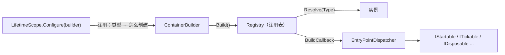
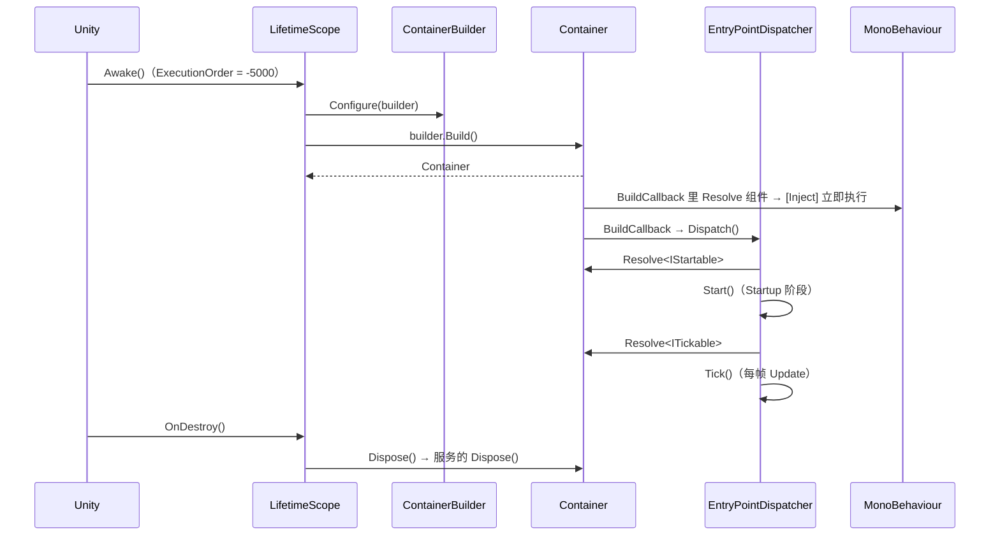
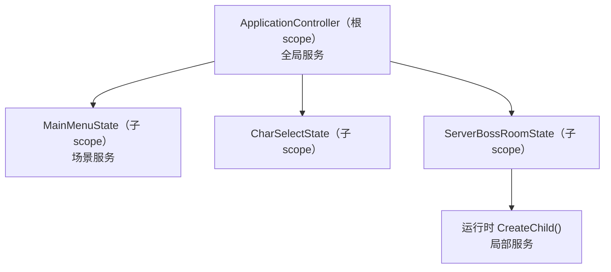

# 10 · VContainer 实战：场景脚本与常见用法手册

> 适用：VContainer **1.11.0**（本工程 `Packages/manifest.json` 里的版本）
> 配套示例：`Assets/Scripts/Examples/VContainerExample/`（可直接运行的场景 + 一键生成场景的编辑器脚本）
> 前置阅读：[01-启动与依赖注入](01-启动与依赖注入.md)、[04-场景与游戏状态](04-场景与游戏状态.md)

这一篇解决三个问题：

1. **VContainer 到底怎么用**——从零写一个能跑的最小例子；
2. **常见写法有哪些**——注册、注入、生命周期、父子容器、EntryPoint 的完整清单；
3. **Boss Room 为什么这么写**——把每一处 DI 代码对回本仓库源码。

---

## 1. 心智模型：容器 = 注册表 + 生命周期

先扔掉"魔法"的印象。VContainer 做的事只有三件：



- **注册**：告诉容器"要 `IScoreService` 时，new 一个 `ScoreService`，并且整个 scope 只留一份"。
- **解析**：容器按构造函数参数（或 `[Inject]` 标记）递归地把依赖装配好。
- **生命周期**：容器负责什么时候创建、什么时候 `Dispose`。

VContainer 不会扫描程序集、不会自动注册、不会在运行时反射查找"谁依赖我"。**没注册就是没有**，解析时直接抛异常——这反而是它比"自动扫描型 DI"好调试的地方。

### 1.1 三个生命周期

| 生命周期 | 实例数量 | 谁来 Dispose | 典型用途 |
| --- | --- | --- | --- |
| `Lifetime.Transient` | 每次 `Resolve` 都新建 | **容器不管**（谁创建谁负责） | 无状态工具类、短生命周期对象 |
| `Lifetime.Singleton` | 整个**根容器**唯一 | 容器 Dispose 时（若实现了 `IDisposable`） | 全局服务：网络、配置、消息总线 |
| `Lifetime.Scoped` | **每个 scope** 一份 | 该 scope Dispose 时 | 场景内共享、离开场景即销毁的服务 |

源码依据（`Container.cs`）：`Scoped` 在解析它的 scope 里缓存（`CreateTrackedInstance`）；`Singleton` 一路委托到 `Root`（`ScopedContainer.ResolveCore` 的 `Lifetime.Singleton` 分支）；`Transient` 每次 `SpawnInstance`。

> 注意：`Singleton` 的"唯一"是**根容器**范围内唯一。子 scope 解析父 scope 注册的 Singleton，拿到的还是根容器那一份。

### 1.2 注入点：只有四种

| 注入方式 | 适用对象 | 说明 |
| --- | --- | --- |
| 构造函数 | 普通 C# 类 | 最推荐；依赖明确、可 readonly |
| `[Inject]` 字段 | MonoBehaviour / ScriptableObject | 字段可以是 `private` |
| `[Inject]` 属性 | 同上 | 属性 setter 会被调用 |
| `[Inject]` 方法 | 同上 | 推荐：一个方法注入多个依赖，便于写初始化逻辑 |

MonoBehaviour 不能用构造函数注入——对象是 Unity 创建的，不是你 `new` 的。

### 1.3 构建时序（非常重要）



`LifetimeScope` 上有 `[DefaultExecutionOrder(-5000)]`，所以它一定**早于**同场景其他 MonoBehaviour 的 `Awake`。这带来一个坑，见 §4.5。

---

## 2. 最小可运行示例（4 个文件）

在任意场景里放一个空 GameObject，挂上 `HelloScope`，按 Play，Console 会打印带时间戳的问候和每帧 tick 的证据。

```csharp
// GameClock.cs
using System;
using UnityEngine;
using VContainer.Unity;

public sealed class GameClock : ITickable, IDisposable
{
    public float Elapsed { get; private set; }

    public void Tick() => Elapsed += Time.deltaTime;      // 每帧被 EntryPointDispatcher 调用

    public void Dispose() => Debug.Log("[DI] GameClock disposed");
}
```

```csharp
// Greeter.cs
public interface IGreeter
{
    string Greet(string name);
}

public sealed class Greeter : IGreeter
{
    readonly GameClock m_Clock;

    public Greeter(GameClock clock) => m_Clock = clock;   // 构造函数注入

    public string Greet(string name) => $"[{m_Clock.Elapsed:0.00}s] Hello, {name}";
}
```

```csharp
// HelloEntryPoint.cs
using UnityEngine;
using VContainer.Unity;

public sealed class HelloEntryPoint : IStartable
{
    readonly IGreeter m_Greeter;

    public HelloEntryPoint(IGreeter greeter) => m_Greeter = greeter;

    public void Start() => Debug.Log(m_Greeter.Greet("VContainer"));
}
```

```csharp
// HelloScope.cs
using VContainer;
using VContainer.Unity;

public sealed class HelloScope : LifetimeScope
{
    protected override void Configure(IContainerBuilder builder)
    {
        builder.Register<GameClock>(Lifetime.Singleton);
        builder.Register<IGreeter, Greeter>(Lifetime.Singleton);
        builder.RegisterEntryPoint<HelloEntryPoint>();
    }
}
```

运行后你会看到：

1. Console 先出现 `[0.00s] Hello, VContainer`（`IStartable.Start` 在第一帧的 Startup 阶段）；
2. 之后每帧 `GameClock.Tick` 都在累加；
3. 停止 Play 时打印 `[DI] GameClock disposed`。

**这一小节已经覆盖了 80% 的日常用法**：注册具体类型、注册接口→实现、构造函数注入、EntryPoint、Dispose。

---

## 3. 本仓库里的完整示例工程

> 位置：`Assets/Scripts/Examples/VContainerExample/`
> 程序集：`Unity.BossRoom.Examples.VContainerExample`（运行时）、`...VContainerExample.Editor`（编辑器）

### 3.1 文件清单

| 文件 | 类型 | 演示的用法 |
| --- | --- | --- |
| `ExampleSettings.cs` | 纯 C# 类 | 用 `RegisterInstance` 注入"现成配置对象" |
| `IScoreService.cs` / `ScoreService.cs` | 接口 + 实现 | `Register<ScoreService>(Singleton).As<IScoreService>().AsSelf()`；构造函数注入 |
| `Bot.cs` | 普通对象 | 由工厂创建、数量不固定 → 不进容器 |
| `ExampleHud.cs` | MonoBehaviour | `[Inject]` 方法注入 + `OnGUI` 显示；注册方式 `RegisterComponent` |
| `ExampleGameLoop.cs` | 普通类 | `IStartable` / `ITickable` / `IDisposable` + 注入 `Func<Bot>` |
| `ExampleSceneScope.cs` | `LifetimeScope` | 六种注册方式集中演示 + `RegisterBuildCallback` |
| `Editor/VContainerExampleSceneBuilder.cs` | 编辑器脚本 | 一键生成场景（相机、灯光、Scope、HUD 引用） |

### 3.2 场景怎么来

**方式 A：菜单一键生成（推荐）**

菜单栏 → `Tools` → `Boss Room` → `VContainer 示例` → `创建示例场景`

脚本做的事：

1. `EditorSceneManager.NewScene(EmptyScene, Single)` 新建空场景；
2. 建 `Main Camera`（带 `AudioListener`）和 `Directional Light`；
3. 建 `VContainerExample` 对象，挂 `ExampleHud` + `ExampleSceneScope`；
4. 用 `SerializedObject` 把 `m_Hud` 引用写进 Scope（等价于你在 Inspector 里拖）；
5. 保存到 `Assets/Scenes/VContainerExample.unity`，并加入 Build Settings。

源码见 `Editor/VContainerExampleSceneBuilder.cs`。

**方式 B：手动搭**

1. 新建场景；
2. 建一个空 GameObject，命名随意；
3. 给它加 `ExampleSceneScope` 和 `ExampleHud`（顺序无所谓，同一个对象即可）；
4. 如果需要，把 HUD 拖到 Scope 的 `m_Hud` 字段（不拖也能跑，`Configure` 里有 `GetComponent` 兜底）；
5. 加一个 Camera 对着原点，按 Play。

### 3.3 运行效果

- 屏幕左上角显示分数、状态文字；
- 每 2 秒在 Scope 周围生成一个随机颜色的 Cube（由 `Func<Bot>` 工厂创建），持续旋转；
- 每秒 `IScoreService.Add(1)`，HUD 立即刷新；
- Console 依次打印：

```
[VContainer] ExampleHud 收到 [Inject] 注入
[VContainer] 容器构建完成，玩家 = VContainer 玩家
[VContainer] ExampleGameLoop.Start(): 初始分数 = 0
... 停止 Play ...
[VContainer] ExampleGameLoop.Dispose(): Scope 已释放
```

### 3.4 六个教学点（对照 `ExampleSceneScope.Configure`）

```csharp
protected override void Configure(IContainerBuilder builder)
{
    // 1) 现成实例：配置对象由你 new，容器只负责注入
    builder.RegisterInstance(new ExampleSettings(m_PlayerName, m_StartingScore, m_SpawnInterval));

    // 2) 接口 → 实现，并同时可用具体类型解析
    builder.Register<ScoreService>(Lifetime.Singleton)
        .As<IScoreService>()
        .AsSelf();

    // 3) 工厂：注册 Func<Bot>，每次调用创建一个
    builder.RegisterFactory<Bot>(CreateBot);

    // 4) 场景里的 MonoBehaviour：立即注入
    builder.RegisterComponent(hud);

    // 5) EntryPoint：普通类也有 Start / Tick / Dispose
    builder.RegisterEntryPoint<ExampleGameLoop>();

    // 6) 容器构建完成后的回调
    builder.RegisterBuildCallback(container =>
        Debug.Log($"[VContainer] 容器构建完成，玩家 = {container.Resolve<ExampleSettings>().PlayerName}"));
}
```

**① `RegisterInstance`**：容器不会 `new` 它，也不会替你 `Dispose` 它（`ExistingInstanceProvider` 被排除在 disposable 收集之外）。适合"外面已经存在的对象"：配置、`Transform`、第三方 SDK 句柄。

**② `.As<T>()` / `.AsSelf()`**：`Register<ScoreService>` 默认注册的是**具体类型** `ScoreService`；`.As<IScoreService>()` 追加一个"接口 → 同一实例"的映射；`.AsSelf()` 保留具体类型解析。`ExampleGameLoop` 构造函数只依赖 `IScoreService`，所以实现可以随时替换。

**③ `RegisterFactory<Bot>(CreateBot)`**：注册的是 `Func<Bot>` 这个**委托**。构造函数注入 `Func<Bot> createBot` 后，每次 `createBot()` 都会调用 `CreateBot()` 新建一个 Bot——这是"需要很多个、生命周期由调用方管理"的对象的正确写法（不要把它们注册成 `Transient` 然后 `Resolve`，那样容器无法跟踪，也拿不到引用）。

**④ `RegisterComponent(hud)`**：把场景里已存在的组件登记进容器，并在**构建容器时立即执行注入**（`RegisterComponent` 内部注册了一个 `RegisterBuildCallback(... Resolve<TInterface>())`，见 `ContainerBuilderUnityExtensions.cs:116-122`）。注意它注册的生命周期是 `Singleton`（`ComponentRegistrationBuilder` 构造函数写死）。

**⑤ `RegisterEntryPoint<T>()`**：等价于 `Register<T>(lifetime).AsImplementedInterfaces()`，并确保 `EntryPointDispatcher` 已注册（`ContainerBuilderUnityExtensions.cs:103-107`）。`ExampleGameLoop` 只依赖接口，不继承 MonoBehaviour，却拿到了 `Start/Tick/Dispose` 回调。

**⑥ `RegisterBuildCallback`**：在 registry 构建完成、所有实例可按需创建之后执行。适合做启动日志、断言、预热。Boss Room 的 `LobbyServiceFacade` 用 `RegisterEntryPoint` 而非 BuildCallback，因为它需要的是"容器好了之后调我的 `Start()`"，而且还要参与 Dispose。

### 3.5 一个容易踩的时序坑

`ExampleHud` 的 `[Inject] Construct` 会在 **`LifetimeScope.Awake` 期间**（也就是 HUD 自己的 `Awake` **之前**）执行。所以：

```csharp
// 错误示范
[Inject]
public void Construct(IScoreService score)
{
    m_SomeFieldInitializedInAwake.DoSomething();  // 可能是 null！
}

void Awake()
{
    m_SomeFieldInitializedInAwake = ...;
}
```

**规则**：`[Inject]` 里只保存引用、订阅事件；不要依赖"自己 `Awake` 里才初始化"的字段，也不要碰"别的组件 `Awake` 里才准备好"的东西。确实需要时，把逻辑放到 `Start()`（Boss Room 的 `GameStateBehaviour.Start()` 就是干这个的）。

---

## 4. 注册 API 全表

下表就是 VContainer 1.11 你日常会用的全部注册入口。

| API | 注册成什么 | 生命周期 | 典型场景 |
| --- | --- | --- | --- |
| `Register<T>(lifetime)` | `T` | 指定 | 普通服务 |
| `Register<TInterface, TImpl>(lifetime)` | `TInterface` | 指定 | 面向接口 |
| `Register<T>(lifetime).As<TInterface>()` | `T` + `TInterface` | 指定 | 既要接口又要具体类型 |
| `RegisterInstance(instance)` | 实例的类型 | Singleton（固定） | 配置、外部对象 |
| `RegisterComponent(component)` | 组件的类型 | Singleton（固定） | 场景里的 MonoBehaviour |
| `RegisterComponentInHierarchy<T>()` | `T` | **Scoped** | 场景里"只有一个"的组件 |
| `RegisterComponentOnNewGameObject<T>(lifetime, name)` | `T` | 指定 | 让容器创建 GameObject |
| `RegisterComponentInNewPrefab<T>(prefab, lifetime)` | `T` | 指定 | 让容器实例化预制体 |
| `RegisterEntryPoint<T>(lifetime)` | `T` + 所有接口 | 默认 Singleton | Start/Tick/Dispose 回调 |
| `RegisterFactory<T>(Func<T>)` | `Func<T>` | 委托单例 | 需要"每次新建"的对象 |
| `RegisterFactory<T>(Func<IObjectResolver, Func<T>>, lifetime)` | `Func<T>` | 指定 | 工厂内部还要解析依赖 |
| `RegisterBuildCallback(Action<IObjectResolver>)` | — | — | 构建完成回调 |
| `WithParameter(name/type/value)` | 附加参数 | — | 构造函数参数不是服务时 |
| `RegisterEntryPointExceptionHandler(Action<Exception>)` | 处理器 | — | 统一捕获 EntryPoint 异常 |

### 4.1 `Register<T>(Lifetime)`

```csharp
builder.Register<ScoreService>(Lifetime.Singleton);
```

解析 `ScoreService` 时，容器会找它**唯一的构造函数**，按参数类型继续解析。找不到的依赖会在 Resolve 时抛 `VContainerException: No such registration of type: X`。

### 4.2 `Register<TInterface, TImpl>(Lifetime)`

```csharp
builder.Register<IScoreService, ScoreService>(Lifetime.Singleton);
// 等价于
builder.Register<ScoreService>(Lifetime.Singleton).As<IScoreService>();
```

### 4.3 `As` / `AsSelf` / `AsImplementedInterfaces`

```csharp
builder.Register<ScoreService>(Lifetime.Singleton)
    .As<IScoreService>()          // 接口
    .AsSelf();                    // 具体类型

builder.RegisterInstance(new MessageChannel<QuitApplicationMessage>())
    .AsImplementedInterfaces();   // 实现的所有接口（Boss Room 常用）
```

`AsImplementedInterfaces()` 会把 `MessageChannel<T>` 实现的所有接口一次性注册，比如 `IPublisher<T>`、`ISubscriber<T>`、`IDisposable`... 这正是 Boss Room 消息总线只写一行就搞定的原因。

### 4.4 `RegisterInstance`

```csharp
builder.RegisterInstance(new ExampleSettings("玩家", 0, 2f));

// 同时注册成多个接口
builder.RegisterInstance(new MessageChannel<ConnectStatus>())
    .AsImplementedInterfaces();
```

- 生命周期固定为 Singleton；
- 容器**不负责 Dispose** 这个实例；
- **不会执行 `[Inject]`**（`ExistingInstanceProvider` 只返回实例，不做注入）。如果对象需要注入，用 `RegisterComponent`，或注册完手动 `container.Inject(obj)`；
- 适合"外部已经构造好"的对象。

### 4.5 `RegisterComponent`（场景组件）

```csharp
[SerializeField] ExampleHud m_Hud;

protected override void Configure(IContainerBuilder builder)
{
    builder.RegisterComponent(m_Hud);            // 按具体类型注册
    // builder.RegisterComponent<IHud>(m_Hud);   // 按接口注册
}
```

- 构建容器时**立即注入**（不等你 Resolve）；
- 注册为 Singleton；
- 传 `null` 会在 `Configure` 里直接抛 `NullReferenceException`（`ComponentRegistrationBuilder` 构造函数就调了 `instance.GetType()`），所以要先判空（示例里用 `GetComponent` 兜底）。

### 4.6 `RegisterComponentInHierarchy<T>()`

```csharp
builder.RegisterComponentInHierarchy<ExampleHud>();
// 或者限定在某个父节点下
builder.RegisterComponentInHierarchy<ExampleHud>()
    .UnderTransform(transform);
```

- 在 `LifetimeScope` 所在的**场景**里找第一个 `T`（`FindComponentProvider`），找不到直接抛异常；
- 生命周期是 **Scoped**；
- 好处：不用在 Inspector 拖引用；坏处：隐式依赖、场景里多个同类组件时只取第一个。

> Boss Room 选择显式 `RegisterComponent(m_Field)`，因为序列化引用能在编辑器里看出"漏挂了"，也不会在场景里做搜索。

### 4.7 让容器创建 GameObject / 预制体

```csharp
builder.RegisterComponentOnNewGameObject<AudioSource>(Lifetime.Singleton, "BGM");
builder.RegisterComponentInNewPrefab(m_ExplosionPrefab, Lifetime.Transient);
```

适合"服务和某个 GameObject 绑定"的情况（音源、特效宿主）。注意这两种方式创建的 GameObject 的生命周期与容器/scope 绑定。

### 4.8 `RegisterEntryPoint<T>`

```csharp
builder.RegisterEntryPoint<ExampleGameLoop>();
// 也可以指定生命周期，并同时用具体类型解析（Boss Room 的写法）
builder.RegisterEntryPoint<LobbyServiceFacade>(Lifetime.Singleton).AsSelf();
```

EntryPoint 支持的回调接口（`VContainer.Unity`）：

| 接口 | 方法 | 调用时机 |
| --- | --- | --- |
| `IInitializable` | `Initialize()` | 容器 Dispatch 时，立刻 |
| `IPostInitializable` | `PostInitialize()` | 所有 Initialize 之后 |
| `IStartable` | `Start()` | 第一帧 Startup 阶段 |
| `IPostStartable` | `PostStart()` | Startup 之后 |
| `ITickable` | `Tick()` | 每帧 Update |
| `IPostTickable` | `PostTick()` | Update 之后 |
| `IFixedTickable` | `FixedTick()` | FixedUpdate |
| `IPostFixedTickable` | `PostFixedTick()` | FixedUpdate 之后 |
| `ILateTickable` | `LateTick()` | LateUpdate |
| `IPostLateTickable` | `PostLateTick()` | LateUpdate 之后 |
| `IDisposable` | `Dispose()` | scope 销毁时 |

> 这些回调由 `EntryPointDispatcher` 通过 `PlayerLoopHelper` 注入 Unity 的 PlayerLoop 驱动（`EntryPointDispatcher.cs:23`、`:98-128`），所以不需要任何 MonoBehaviour。

异常处理：

```csharp
builder.RegisterEntryPointExceptionHandler(ex => Debug.LogException(ex));
```

### 4.9 `RegisterFactory`

```csharp
// 1) 简单工厂：注册 Func<Bot>
builder.RegisterFactory<Bot>(() => new Bot(CreateTransform()));

// 2) 工厂里还要用容器解析依赖
builder.RegisterFactory<Bot>(
    resolver =>
    {
        var settings = resolver.Resolve<ExampleSettings>();
        return () => new Bot(settings);
    },
    Lifetime.Singleton);
```

要点：注册的是**委托**，不是 `Bot`。想要"每次 Resolve 都新建"用 `Lifetime.Transient` 也可以，但那样你拿不到容器之外的引用，也不方便传入运行时参数。

### 4.10 `RegisterBuildCallback`

```csharp
builder.RegisterBuildCallback(container =>
{
    Debug.Log($"容器构建完成：{container.Resolve<ExampleSettings>().PlayerName}");
});
```

执行顺序 = 注册顺序。`RegisterComponent` / `RegisterEntryPoint` 内部也会注册回调，所以**先注册组件、再注册 EntryPoint**，能保证 EntryPoint 的 `Start` 执行时组件已经注入完毕。

### 4.11 `WithParameter`（构造函数参数不是服务）

```csharp
public sealed class PlayerService
{
    public PlayerService(string playerName, int level) { ... }
}

builder.Register<PlayerService>(Lifetime.Singleton)
    .WithParameter("playerName", "张三")   // 按参数名
    .WithParameter(typeof(int), 42);       // 按类型
```

只影响**构造函数 / [Inject] 方法**的参数解析；能不用就不用，优先把配置封装成对象再 `RegisterInstance`。

### 4.12 集合注入

同一种接口注册多个实现后，可以注入 `IEnumerable<T>` 或 `IReadOnlyList<T>`：

```csharp
builder.Register<IEnemy, Slime>(Lifetime.Singleton);
builder.Register<IEnemy, Bat>(Lifetime.Singleton);

// 构造函数里
public EnemyRegistry(IEnumerable<IEnemy> enemies) { ... }
```

- 没有注册任何实现时，集合是**空集合**（不是 null，也不抛异常）；
- 单数解析 `IEnemy` 的行为取决于注册顺序，**不要依赖**；要全部就用集合。

---

## 5. 注入方式六种写法

### 5.1 构造函数（首选）

```csharp
public sealed class ScoreService : IScoreService
{
    readonly ExampleSettings m_Settings;
    public ScoreService(ExampleSettings settings) => m_Settings = settings;
}
```

### 5.2 `[Inject]` 字段

```csharp
public sealed class PartyHUD : MonoBehaviour
{
    [Inject] ConnectionManager m_ConnectionManager;
}
```

Boss Room 里大量这种写法：`ServerCharSelectState`、`ServerBossRoomState`、`ConnectionManager` 都是。

### 5.3 `[Inject]` 属性

```csharp
[Inject] public IScoreService ScoreService { get; private set; }
```

### 5.4 `[Inject]` 方法（MonoBehaviour 推荐）

```csharp
[Inject]
public void Construct(IScoreService scoreService, IObjectResolver resolver)
{
    m_ScoreService = scoreService;
    m_Resolver = resolver;
    scoreService.ScoreChanged += OnScoreChanged;
}
```

一个方法注入多个依赖，还能顺手做订阅。**只保存引用、订阅事件**，别在这里做重活（原因见 §3.5）。

### 5.5 手动注入

```csharp
// 1) 给一个已存在的对象补注入
container.Inject(someObject);

// 2) 给整个 GameObject 层级（递归子节点）补注入
container.InjectGameObject(gameObject);

// 3) 实例化预制体并注入
var instance = container.Instantiate(prefab, position, rotation, parent);
```

`InjectGameObject` 会递归遍历子节点（`ObjectResolverUnityExtensions.cs:12-31`），适合"运行时动态生成的一整棵 UI"。

### 5.6 注入 `IObjectResolver` 本身

```csharp
public sealed class ConnectionManager : MonoBehaviour
{
    [Inject] IObjectResolver m_Resolver;
}
```

Boss Room 用它来在运行时按需解析（`m_Resolver.Resolve<...>()`）。这是**服务定位器**模式，能不用就不用：依赖不明确、测试难替换。它的合理场景是"要解析的类型在编译期不确定"或"创建时机很晚"。

---

## 6. 作用域与父子容器

### 6.1 什么时候需要子 scope

- 每个场景一个"场景级服务"（进入场景创建，离开销毁）；
- 一个 UI 面板一个 scope（面板关闭时释放它持有的资源）；
- Boss Room 的 `LobbyServiceFacade`：在运行时为一个"大厅会话"创建子 scope 管理 `LobbyAPIInterface`。

### 6.2 创建子 scope 的四种方式

```csharp
// 1) 运行时创建（Boss Room 用法，LobbyServiceFacade.cs:48）
LifetimeScope child = m_ParentScope.CreateChild(builder =>
{
    builder.Register<LobbyAPIInterface>(Lifetime.Singleton);
});
var api = child.Container.Resolve<LobbyAPIInterface>();

// 2) 从预制体创建（预制体自带 LifetimeScope）
LifetimeScope child = parentScope.CreateChildFromPrefab(scopePrefab, builder => { ... });

// 3) 静态 Enqueue：让"下一次创建的任何 scope"临时挂到指定父级/追加注册
using (LifetimeScope.EnqueueParent(rootScope))
using (LifetimeScope.Enqueue(b => b.Register<IFoo, Foo>(Lifetime.Singleton)))
{
    SceneManager.LoadScene("MainMenu");
}

// 4) 代码里直接建一个独立容器（测试常用）
var scope = LifetimeScope.Create(builder => builder.Register<IFoo, Foo>(Lifetime.Singleton));
```

### 6.3 父级怎么指定：`parentReference`

`LifetimeScope` 的 `parentReference` 有两个字段：

```csharp
[Serializable]
public struct ParentReference
{
    [SerializeField] public string TypeName;      // 序列化保存的是类型全名
    [NonSerialized]  public LifetimeScope Object; // 运行时才能拿到的直接引用
    public Type Type { get; private set; }
}
```

也就是说：**Inspector 里只能按类型名指定父 scope**，因为跨场景的对象引用没法序列化。运行时 `GetRuntimeParent()` 会用 `FindObjectOfType(type)` 找到那个 scope。

Boss Room 的场景状态预制体就是这么写的（`Assets/Prefabs/State/CharSelectState.prefab`）：

```yaml
parentReference:
  TypeName: Unity.BossRoom.ApplicationLifecycle.ApplicationController
```

所以每个场景的 `GameStateBehaviour` 都能找到 `Startup` 里 `DontDestroyOnLoad` 的 `ApplicationController`，用它的容器做父容器。

### 6.4 解析顺序



解析 `T` 时，从**当前 scope 往上找**，找到第一个注册就用它（`ScopedContainer.FindRegistration` 沿 `Parent` 链遍历）。因此：

- 子 scope 可以用父 scope 的所有服务；
- 子 scope 注册同名类型会**覆盖**父级（靠近的优先）；
- 用完记得 `Dispose()`，否则 Singleton 不会被释放。

### 6.5 `autoInjectGameObjects`

`LifetimeScope` 有一个 Inspector 列表 `autoInjectGameObjects`：容器构建完成后，对列表里每个 GameObject 调 `InjectGameObject`（递归子节点）。

Boss Room 的 `MainMenu` / `CharSelect` / `BossRoom` 场景都用它把 UI 根节点纳入注入范围（场景 YAML 里的 `autoInjectGameObjects.Array.data[i]`）。这比自己写一堆 `RegisterComponent` 省事，但**只做注入、不做注册**：被注入的对象本身不能被别人 `Resolve`。

---

## 7. 常见配方（Cookbook）

### 7.1 用接口替换实现（测试 / 平台差异）

```csharp
builder.Register<IScoreService, ScoreService>(Lifetime.Singleton);

#if UNITY_EDITOR || DEVELOPMENT_BUILD
builder.Register<ICheatService, EditorCheatService>(Lifetime.Singleton);
#else
builder.Register<ICheatService, NullCheatService>(Lifetime.Singleton);
#endif
```

Boss Room 的作弊通道就是这么控制的（`ApplicationController.cs:64-66`）。

### 7.2 配置对象注入：ScriptableObject 还是实例？

```csharp
// A. ScriptableObject 资产：拖到 Scope 上，再 RegisterInstance
[SerializeField] CharacterClass m_Class;
builder.RegisterInstance(m_Class);

// B. 代码构造的配置对象
builder.RegisterInstance(new ExampleSettings(...));
```

两者本质相同：**容器不创建配置，只传递引用**。区别是 ScriptableObject 能在编辑器里可视化编辑、可被多个 scope 共享。

### 7.3 工厂：需要"每次新建"

见 §3.4 ③。要点：工厂返回的对象不要注册进容器；容器只持有 `Func<T>`。

### 7.4 循环依赖

`A` 依赖 `B`，`B` 又依赖 `A`，构造函数注入会死循环。三种解法：

```csharp
// 1) 注入 Func<T>，延迟到真正需要时再取（最推荐）
builder.Register<A>(Lifetime.Singleton);
builder.RegisterFactory<B>(resolver => () => resolver.Resolve<B>(), Lifetime.Singleton);

// 2) 注入 IObjectResolver，运行时再 Resolve（服务定位器）
public A(IObjectResolver resolver) { ... }

// 3) 抽出第三个服务 C，让 A、B 都依赖 C（最好的设计）
```

### 7.5 条件注册 / 环境差异

```csharp
if (Application.isEditor)
{
    builder.Register<ILogger, EditorLogger>(Lifetime.Singleton);
}
else
{
    builder.Register<ILogger, PlayerLogger>(Lifetime.Singleton);
}
```

### 7.6 场景覆盖父级服务

```csharp
// 子 scope（场景）里重新注册同名类型 → 该场景内解析到新实现
protected override void Configure(IContainerBuilder builder)
{
    builder.Register<IAudioService, MuteAudioService>(Lifetime.Singleton);
}
```

### 7.7 运行时创建带依赖的 MonoBehaviour

```csharp
var hud = container.Instantiate(m_HudPrefab, parent);
// 或者
var go = new GameObject("HUD");
go.AddComponent<ExampleHud>();
container.InjectGameObject(go);
```

### 7.8 把场景对象纳入容器（两种风格）

```csharp
// 显式引用（Boss Room 风格）：编译期就能看出依赖，漏挂会报错
[SerializeField] UpdateRunner m_UpdateRunner;
builder.RegisterComponent(m_UpdateRunner);

// 场景搜索：省事但隐式
builder.RegisterComponentInHierarchy<UpdateRunner>();
```

### 7.9 消息通道（Boss Room 风格）

```csharp
// 本地通道：实例注册 + 所有接口
builder.RegisterInstance(new MessageChannel<ConnectStatus>())
    .AsImplementedInterfaces();

// 网络通道：它是普通类（不是 MonoBehaviour），但内部有 [Inject] 方法需要 NetworkManager，
// 所以必须用 RegisterComponent（会执行注入）；用 RegisterInstance 则不会注入
builder.RegisterComponent(new NetworkedMessageChannel<ConnectionEventMessage>())
    .AsImplementedInterfaces();
```

> 源码注释写得很清楚：实例注册是为了 **防止 iOS 代码裁剪**（泛型类型没有被任何地方直接引用时会被裁掉）。这是个很实用的经验。

### 7.10 不要每帧 `Resolve`

```csharp
// 反例：每帧查表 + 可能抛异常
void Update() => m_Container.Resolve<IScoreService>().Add(1);

// 正例：构造/注入时拿一次引用
readonly IScoreService m_Score;
public Foo(IScoreService score) => m_Score = score;
```

`Resolve` 有字典查找开销，且放在热路径上会把"缺注册"变成每帧异常。VContainer 的卖点是"注册期整理好类型表、运行期快速解析"（配合 codegen 连反射都省掉），别把它当 Service Locator 每帧查。

---

## 8. 与 Boss Room 源码对照

| Boss Room 代码 | 用到的 VContainer 能力 | 说明 |
| --- | --- | --- |
| `ApplicationController : LifetimeScope` | 根 scope | 游戏启动时构建，`DontDestroyOnLoad` 常驻 |
| `ApplicationController.cs:40-42` `RegisterComponent(m_UpdateRunner/m_ConnectionManager/m_NetworkManager)` | 场景组件注册 | 三个都是 `Startup` 场景里的对象 |
| `ApplicationController.cs:46-51` `Register<T>(Singleton)` | 生命周期 | `LocalLobby`、`LocalLobbyUser`、`ProfileManager`、`PersistentGameState` 跨场景存活 |
| `ApplicationController.cs:55-72` `RegisterInstance(...).AsImplementedInterfaces()` | 实例 + 多接口 | 消息通道；注释说明防裁剪 |
| `ApplicationController.cs:78` `RegisterEntryPoint<LobbyServiceFacade>(Singleton).AsSelf()` | EntryPoint | 需要 `Start()` 和 `Dispose()` |
| `ApplicationController.cs:83-86` `Container.Resolve<...>()` | 手动解析 | 只在 `Start` 里做一次 |
| `GameStateBehaviour : LifetimeScope` | 每场景子 scope | `Awake` 里 `base.Awake()` 建容器 |
| `Assets/Prefabs/State/*.prefab` 的 `parentReference.TypeName` | 按类型找父级 | 指向 `ApplicationController` |
| `ServerCharSelectState` 的 `[Inject] ConnectionManager` | 字段注入 | 跨场景服务在子 scope 中解析 |
| `ServerBossRoomState` 的 `[Inject] ISubscriber<...>` | 接口注入 | 消息通道的订阅端 |
| `ConnectionManager` 的 `[Inject] IObjectResolver` | 容器自身注入 | 连接状态机运行时解析 |
| `LobbyServiceFacade.cs:48` `m_ParentScope.CreateChild(...)` | 子 scope | 大厅会话的局部服务 |
| `LobbyServiceFacade` 的 `[Inject] LifetimeScope m_ParentScope` | 注入 scope 自身 | `LifetimeScope` 会把自己注册进容器（`LifetimeScope.cs:243`） |
| `GameStateBehaviour.cs:61-64` `Parent.Container.Inject(this)` | 手动注入 | 父容器给子 scope 的组件做注入 |

---

## 9. 常见报错与排查

| 现象 | 原因 | 解决 |
| --- | --- | --- |
| `VContainerException: No such registration of type: X` | 没注册；或父 scope 没找到，子 scope 自己成了根 | 注册 `X`；检查 `parentReference.TypeName`；确认根 scope 已 Build |
| `VContainerParentTypeReferenceNotFound` | `TypeName` 指定的 scope 不在场景里 | 确认 `ApplicationController` 已加载（先启动 `Startup`） |
| `[Inject]` 里 `NullReferenceException` | 依赖了自己 `Awake` 才初始化的字段 | 移到 `Start`，或改成注入的服务（§3.5） |
| `RegisterComponent(null)` 注册时报错 | Inspector 引用没拖 | 判空 + `GetComponent` 兜底 |
| 改了脚本不生效 | Play Mode 中不重编译；或脚本编译报错 | 退出 Play，`Ctrl+R`；看 Console |
| 子 scope 里解析不到父服务 | 父 scope 还没 Build（Awake 顺序）或 `TypeName` 写错 | 用 `DontDestroyOnLoad` 保证根 scope 先存在 |
| 停止 Play 后事件还在触发 | 没在 `Dispose` 里退订 | 实现 `IDisposable`，或用 `DisposableGroup`（Boss Room 风格） |
| iOS 上消息通道为 null | 泛型类型被裁剪 | `RegisterInstance` + `AsImplementedInterfaces`（Boss Room 注释） |
| `VContainerSettings` 找不到 | 没有创建 Settings 资产 | `Assets > Create > VContainer > VContainer Settings` |

调试工具：创建 `VContainerSettings` 资产并勾选 `Enable Diagnostics`，然后打开 `Window > VContainer Diagnostics`，可以看到每个 scope 的注册表和解析次数（有性能开销，只在排查时开）。

---

## 10. 在测试里用容器

```csharp
[Test]
public void ScoreService_AddsPoints()
{
    var builder = new ContainerBuilder();
    builder.RegisterInstance(new ExampleSettings("test", 0, 1f));
    builder.Register<IScoreService, ScoreService>(Lifetime.Singleton);

    using var container = builder.Build();
    var score = container.Resolve<IScoreService>();

    score.Add(3);
    Assert.AreEqual(3, score.Score);
}
```

- `new ContainerBuilder()` + `Build()`：不依赖场景，纯逻辑测试最快；
- 需要 `LifetimeScope` 行为（Awake、父子、EntryPoint）时，用 PlayMode 测试 + `LifetimeScope.Create(...)`；
- 想验证"Singleton 只创建一次"：在构造函数里累加静态计数，断言等于 1。

Boss Room 的 `Assets/Tests/Runtime` 里有现成的容器使用范例（`ConnectionManagementTests`、`MessageChannelTest`）。

---

## 11. 性能与代码生成

VContainer 默认用**反射**读 `[Inject]` 和构造函数。1.11 提供了 IL 后处理代码生成，把反射调用改写成直接 IL：

1. 在程序集的 `.asmdef` 的 `references` 里加上 `VContainer.EnableCodeGen`（Boss Room 的 `Unity.BossRoom.ApplicationLifecycle.asmdef` 就这么做）；
2. 编辑器里的 `Unity.VContainer.CodeGen`（ILPostProcessor）检测到该引用后，在编译产物上重写注入代码（`VContainerILPostProcessor.WillProcess`：同时引用 `VContainer` 和 `VContainer.EnableCodeGen` 才处理）；
3. 运行时不再走反射，IL2CPP 下也更友好。

注意事项：

- 只对**加了该引用的程序集**生效；
- 修改后需要重新编译（Play Mode 中不会重编）；
- 出问题时可先去掉引用，退回反射路径定位。

---

## 12. 练习题

1. 把 §2 的 `Greeter` 改成"接口 + 两个实现"，用 `#if UNITY_EDITOR` 在编辑器里注册 `VerboseGreeter`，打包时注册 `SimpleGreeter`。
2. 给示例工程加一个 `IPauseService`：`ExampleHud` 用 `[Inject]` 方法注入并在 `OnGUI` 显示暂停状态；`ExampleGameLoop` 在暂停时跳过 `Tick` 逻辑。
3. 用 `CreateChild` 给每一波 Bot 建一个子 scope，注册 `WaveSettings`（`Lifetime.Scoped`），验证两波之间拿到的不是同一个实例。
4. 写一个 PlayMode 测试：断言 `Lifetime.Singleton` 服务在同一个 scope 内只创建一次，`Lifetime.Transient` 每次解析都新建。
5. 把 `ExampleSceneScope` 里的 `RegisterComponent(hud)` 改成 `RegisterComponentInHierarchy<ExampleHud>()`，运行并解释两者在生命周期和失败行为上的区别。
6. 给示例程序集加 `VContainer.EnableCodeGen`，用 Profiler 对比注入阶段的耗时（或用 `Stopwatch` 包住 `Build()`）。

<details>
<summary>答案要点</summary>

1. `builder.Register<IGreeter, VerboseGreeter>()` / `SimpleGreeter`，用 `#if` 包住；注意两个实现都要有可解析的构造函数。
2. `PauseService` 注册为 Singleton；`ExampleGameLoop` 构造注入并在 `Tick` 里 `if (m_Pause.IsPaused) return;`；HUD 的 `[Inject]` 里保存引用，`OnGUI` 读属性。
3. `var wave = m_Scope.CreateChild(b => b.Register<WaveSettings>(Lifetime.Scoped));`，`wave.Container.Resolve<WaveSettings>()` 每波不同；记得 `wave.Dispose()`。
4. 用静态计数器在构造函数里自增；`container.Resolve<T>()` 两次比较计数。
5. `RegisterComponent` 是显式引用、Singleton、构建时立刻注入、null 直接暴露；`RegisterComponentInHierarchy` 是 Scoped、在场景里搜索、找不到抛 `VContainerException`、场景里多个同类只取第一个。
6. 加 asmdef 引用后重新编译；注入从反射变为 IL 直调，`Build()` 与首次 `Resolve` 的耗时下降，IL2CPP 下更明显。

</details>

---

## 13. 速查卡

```csharp
// —— 注册 ——
builder.Register<T>(Lifetime.Singleton);
builder.Register<TInterface, TImpl>(Lifetime.Singleton);
builder.Register<T>(Lifetime.Singleton).As<TInterface>().AsSelf();
builder.RegisterInstance(instance);                       // 不 Dispose
builder.RegisterComponent(component);                      // 立即注入
builder.RegisterComponentInHierarchy<T>();                 // Scoped，场景搜索
builder.RegisterComponentOnNewGameObject<T>(lifetime);
builder.RegisterComponentInNewPrefab(prefab, lifetime);
builder.RegisterFactory<T>(() => new T());                 // 注册 Func<T>
builder.RegisterEntryPoint<T>();                           // Start/Tick/Dispose
builder.RegisterBuildCallback(c => { });
builder.Register<T>(lifetime).WithParameter("name", value);

// —— 注入 ——
public Ctor(IDep dep) { }                                  // 构造函数
[Inject] IDep m_Dep;                                       // 字段
[Inject] public IDep Dep { get; private set; }             // 属性
[Inject] public void Construct(IDep dep) { }               // 方法
container.Inject(obj);                                     // 手动
container.InjectGameObject(go);                            // 手动（递归）
container.Instantiate(prefab, parent);                     // 实例化并注入

// —— 作用域 ——
LifetimeScope.CreateChild(b => { ... });
parent.CreateChildFromPrefab(prefab, b => { ... });
LifetimeScope.EnqueueParent(scope);
LifetimeScope.Enqueue(b => { ... });
// parentReference.TypeName = "命名空间.父Scope类型"

// —— 生命周期 ——
Lifetime.Transient   // 每次新建，容器不管 Dispose
Lifetime.Singleton   // 根容器唯一
Lifetime.Scoped      // 每个 scope 一份
```

---

## 14. 下一步

- 想理解"为什么 Boss Room 每个场景一个 scope"：读 [04-场景与游戏状态](04-场景与游戏状态.md)；
- 想看 DI 如何服务于网络层：读 [02-连接流程与状态机](02-连接流程与状态机.md)；
- 想看 DI 如何组织 UI：读 [08-UI-调试与扩展](08-UI-调试与扩展.md)。
