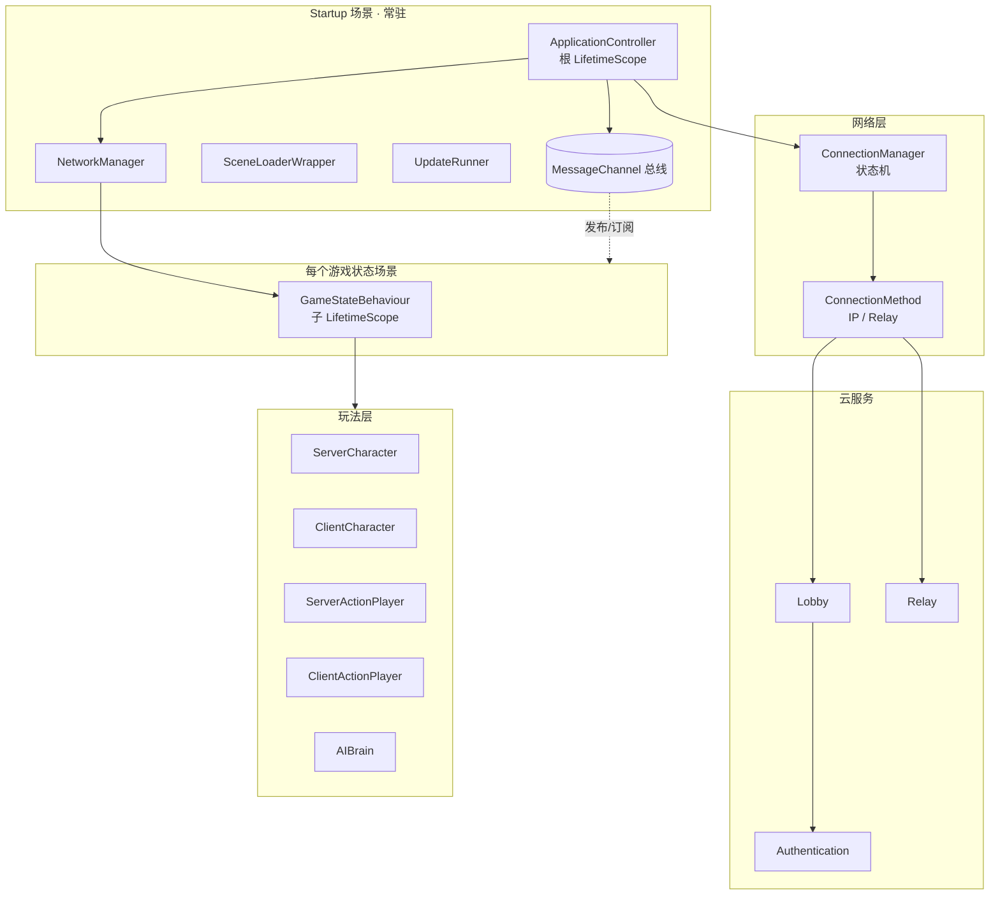
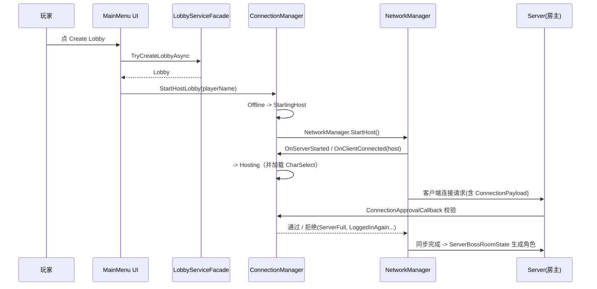

# Boss Room v2.5.0 源码解析 · 总览与阅读路线

> 适用工程：`com.unity.multiplayer.samples.coop` **v2.5.0**（Unity 官方 2022.3 LTS 版本）
> 目标读者：已经通读过 Netcode for GameObjects 文档、想弄懂"一个真正的联网游戏怎么把这些 API 组织起来"的开发者。

这套文档不是 API 手册，而是**带你顺着代码走一遍**：从启动场景、连接状态机、Lobby/Relay，到场景即状态、动作系统、角色同步，最后到 UI、调试与扩展。

> **环境说明（本工程当前状态）**
> - 编辑器：Unity **2022.3.62f3c1**。
> - 本工程是官方 **v2.5.0** 发布版；`com.unity.netcode.gameobjects` 固定为 **1.8.1**（与 `com.unity.transport` 2.0.2 匹配）。
> - 不要把 netcode 升到 1.12+：其包内 `Tests/Runtime/NetworkManagerTransportTests.cs` 使用了新 API，会和 transport 2.0.2 冲突导致编译报错。
> - `manifest.json` 里保留了 `testables: ["com.unity.netcode.gameobjects"]`，因为 `Assets/Tests/Runtime` 依赖 `Unity.Netcode.TestHelpers.Runtime`。

---

## 0. 先建立全局印象

Boss Room 是一个 1~8 人的合作动作 RPG Demo：玩家在 CharSelect 选职业，一起进入 BossRoom 打小怪和 Boss，死了会 faint、可被复活，Boss 死亡或全员倒下进入 PostGame。

它最值得学的不是"怎么发 RPC"，而是**工程结构**：

1. **依赖注入（VContainer）** 把网络层、UI、服务解耦，避免满屏 `FindObjectOfType`。
2. **连接状态机** 把"点按钮"变成"状态迁移"，重连、断线、房间满等异常路径都有落点。
3. **场景即游戏状态**：MainMenu / CharSelect / BossRoom / PostGame 是四个场景，切换场景 = 切换游戏状态，每个场景自带一个 `LifetimeScope` 管理该状态的依赖。
4. **服务端权威 + 客户端表现分离**：同一个"动作"在服务端跑逻辑、在客户端跑特效，代码用 `partial class` 拆成两份。
5. **对象池 + 预制体处理器** 处理高频生成物（投射物）。

### 技术栈

| 分类 | 包 / 版本 | 在项目里的角色 |
| --- | --- | --- |
| 网络 | `com.unity.netcode.gameobjects` 1.8.1 | NetworkObject / NetworkVariable / RPC / NetworkSceneManager |
| 传输 | `com.unity.transport` 2.0.2 | UTP，被 Relay / IP 直连复用 |
| 中继 | `com.unity.services.relay` 1.0.5 | 免公网 IP 的 P2P 中继，拿到 join code |
| 大厅 | `com.unity.services.lobby` 1.2.2 | 房间列表、玩家数据、Relay join code 的载体 |
| 认证 | `com.unity.services.authentication` 2.7.4 | 匿名登录，提供 PlayerId |
| DI | `jp.hadashikick.vcontainer` 1.11.0 | LifetimeScope / `[Inject]` / EntryPoint |
| 渲染 | URP 14.0.12 | 画面 |
| 相机 | Cinemachine 2.10.3 | 跟随相机 |
| 寻路 | `com.unity.ai.navigation` 1.1.6 | NavMeshAgent / NavMeshSurface |
| 调试 | `com.unity.multiplayer.tools` 2.0.0-pre.3 | NetworkStats / NetworkSimulator（模拟延迟丢包） |
| 测试 | `com.unity.test-framework` 1.1.33 | `Assets/Tests/Runtime` |

### 目录地图（`Assets/Scripts`）

```
ApplicationLifecycle/   启动入口、根 LifetimeScope、全局消息注册
ConnectionManagement/   连接状态机（Offline/Hosting/Client...）、连接方式（IP/Relay）、payload
Gameplay/
  Action/               动作系统（ScriptableObject 逻辑 + 服务端/客户端双实现 + 对象池）
  GameState/            每个场景一个 GameStateBehaviour(同时也是 LifetimeScope)
  GameplayObjects/      角色、AI、可破坏物、刷怪器、伤害接口
  UserInput/            输入采集 -> 转成 ActionRequestData -> 发服务端
  UI/                   HUD、弹窗、Lobby/CharSelect UI、Mediator
  Configuration/        ScriptableObject 配置（角色、Avatar、可视化）
  Messages/             跨端事件（门、生死、连接）
Infrastructure/         UpdateRunner、对象池、消息通道、ScriptableObject 架构
UnityServices/          Auth / Lobby 封装
Utils/                  ProfileManager、ClientPrefs、位置插值、NetworkOverlay / 弱网模拟 UI
Editor/                 启动场景引导、构建工具
Packages/com.unity.multiplayer.samples.coop/Utilities/
                        SceneLoaderWrapper、NetcodeHooks、SessionManager 等可复用工具
```

---

## 1. 架构分层



**记住三条主线**，后面所有章节都挂在这三条线上：

- **线 A：怎么连上** —— `MainMenu UI → LobbyServiceFacade → ConnectionMethod → Relay/UTP → ConnectionManager 状态机 → NetworkManager.StartHost/StartClient`
- **线 B：怎么切场景** —— `NetworkManager.SceneManager.LoadScene → SceneLoaderWrapper 回调 → 旧 GameState 卸载 / 新 GameState 的 LifetimeScope 建立`
- **线 C：怎么打架** —— `ClientInputSender → ServerPlayActionRpc → ServerActionPlayer 队列 → Action.OnStart/OnUpdate → 扣血/生成投射物 → ClientPlayActionRpc → ClientActionPlayer 播特效`

---

## 2. 推荐阅读路线（8 站）

按顺序读，每站先读"必读文件"，再看对应章节。**建议一边读一边在 Unity 里双开跑起来**（见第 4 节），否则很多"为什么"体会不到。

| 站 | 主题 | 必读文件 | 对应文档 |
| --- | --- | --- | --- |
| 1 | 启动与依赖注入 | `ApplicationLifecycle/ApplicationController.cs`、`Infrastructure/UpdateRunner.cs`、`Infrastructure/PubSub/*` | [01-启动与依赖注入](01-启动与依赖注入.md) |
| 2 | 连接状态机 | `ConnectionManagement/ConnectionManager.cs`、`ConnectionState/*.cs`、`ConnectionMethod.cs` | [02-连接流程与状态机](02-连接流程与状态机.md) |
| 3 | Lobby / Relay / 认证 | `UnityServices/Lobbies/LobbyServiceFacade.cs`、`LocalLobby.cs`、`Auth/AuthenticationServiceFacade.cs` | [03-大厅-中继-认证](03-大厅-中继-认证.md) |
| 4 | 场景即状态 | `Gameplay/GameState/GameStateBehaviour.cs`、`ServerCharSelectState.cs`、`ServerBossRoomState.cs` | [04-场景与游戏状态](04-场景与游戏状态.md) |
| 5 | 动作系统 | `Action/Action.cs`、`ActionConfig.cs`、`ActionPlayers/*.cs`、`ConcreteActions/MeleeAction*.cs` | [05-动作系统](05-动作系统.md) |
| 6 | 角色与同步 | `Character/ServerCharacter.cs`、`ClientCharacter.cs`、`ServerCharacterMovement.cs`、`AI/*` | [06-角色-移动-战斗同步](06-角色-移动-战斗同步.md) |
| 7 | 网络原语与工具 | `NetworkObjectPool.cs`、`SceneLoaderWrapper.cs`、`NetcodeHooks.cs`、`SessionManager.cs` | [07-网络同步机制与工具](07-网络同步机制与工具.md) |
| 8 | UI、调试、扩展 | `Gameplay/UI/*`、`Editor/*`、`Assets/Tests/Runtime` | [08-UI-调试与扩展](08-UI-调试与扩展.md) |

最后一站：[09-文件索引与术语表](09-文件索引与术语表.md) —— 全量文件清单 + 术语对照，当字典用。

**加餐**：[10-VContainer实战示例](10-VContainer实战示例.md) —— 从零写一个可运行的 VContainer 场景（`Assets/Scripts/Examples/VContainerExample`），并列出注册/注入/生命周期/父子容器的全部常见写法，附 Boss Room 源码对照。

---

## 3. 一次完整对局的时序（先看个全景）



完整对局：`Startup → MainMenu → CharSelect → BossRoom → PostGame`，`Startup` 常驻不卸载，其余场景由 `NetworkSceneManager` 切。

---

## 4. 跑起来（联调环境）

这个版本没有集成 Multiplayer Play Mode（v3 才加入），最省事的两种方式：

**方式 A：编辑器 + 独立构建**

1. `File > Build Settings` 勾选 `Startup / MainMenu / CharSelect / BossRoom / PostGame` 五个场景（`Startup` 必须在索引 0）。
2. Build 一份 Windows 客户端。
3. 编辑器里 Play（`SceneBootstrapper` 会自动跳到 Startup 场景），选 Host。
4. 运行构建出的 exe，选 Join（Lobby 列表 / Join Code / IP 直连都行）。

> 同一台机器上跑两份，**必须用不同的认证 Profile**，否则会被判定为"同一账号重复登录"（`ConnectStatus.LoggedInAgain`）。
> 编辑器启动参数：`-AuthProfile xxx`；打包版同样支持该参数（见 `ProfileManager.GetProfile`）。

**方式 B：项目内 IP 直连**（不需要 UGS，最方便验证 Netcode 本身）

MainMenu → `IP Host` / `IP Join`，走 `ConnectionMethodIP`，`127.0.0.1:9998`。注意 IP 模式下 `ConnectStatus` 逻辑一样，但没有 Lobby/Relay。

**模拟网络状况**：`Unity Multiplayer Tools` 的 NetworkSimulator（挂在 NetworkManager 上），可加 100~200ms 延迟和丢包，用来观察客户端预测/插值表现。

---

## 5. 这份文档怎么用

- 每章开头有"读完你应该能回答"，结尾有"动手练习"，练习都是可以在 30 分钟内改代码验证的。
- 代码片段是**节选**，行号会随版本漂移，请以 `文件:行号` 为线索去读原文。
- 遇到不熟的 Netcode 概念（NetworkVariable 权限、RPC 的 `SendTo`、场景同步 `OnSynchronizeComplete`），先回去查官方文档，这里只讲**它在这个项目里怎么用、为什么这么用**。

---

## 6. 三个"设计上最值得抄"的点

1. **`GameStateBehaviour` 继承 `LifetimeScope`**
   场景切换自动 = 依赖容器重建，天然解决"切换场景后旧引用失效"。见 [04](04-场景与游戏状态.md)。

2. **连接状态用显式状态类，而不是 if/else**
   每个状态一个类、负责"进入时做什么 + 收到事件后跳去哪"，重连逻辑（`ClientReconnectingState`）因此只有 140 行。见 [02](02-连接流程与状态机.md)。

3. **Action 是 ScriptableObject，且 `partial` 拆客户端/服务端**
   策划配数值（`ActionConfig`）不改代码；同一个类里 `OnStart/OnUpdate` 跑服务端、`OnStartClient/OnUpdateClient` 跑客户端，逻辑与表现彻底分离且强关联。见 [05](05-动作系统.md)。

---

*文档基于仓库代码逐文件阅读整理；如与代码不一致，以代码为准。*
